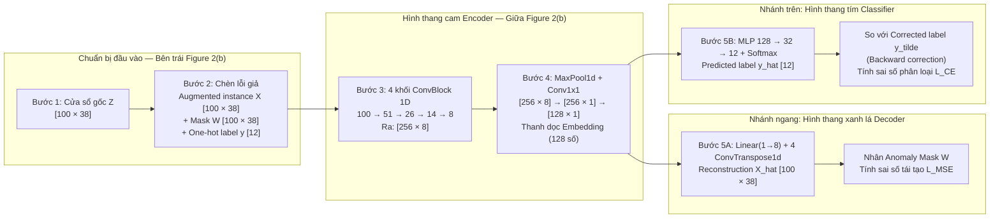

# Hướng Dẫn Từng Bước Luồng Tính Toán Của Mô Hình `ConvAEC` (REDLAMP — KDD '25)

Tài liệu này diễn giải chi tiết **từng phép nhân – cộng – biến đổi kích thước mảng** bên trong kiến trúc **`ConvAEC`** của REDLAMP thông qua một ví dụ tính nhẩm cụ thể trên bộ dữ liệu **`SMD`**, đồng thời ánh xạ trực tiếp **1–1** với sơ đồ **Figure 2(b)** trong bài báo gốc (`2505.20765v1.pdf`, trang 4) và mã nguồn PyTorch (`RedLamp/loaders/loader_aug.py`, `RedLamp/models/cnn.py`, `RedLamp/models/meta.py`, `RedLamp/models/classifier.py`).

---

## 1. Phân Cấp Dữ Liệu & Giải Trừ Các Hiểu Nhầm Dễ Gặp

### 1.1. Phân biệt rõ: `Dataset` vs. `Entity (Machine)` vs. `Channel (Kênh)`
Trên bộ dữ liệu máy chủ **`SMD`**, ba khái niệm này nằm ở các cấp độ hoàn toàn khác nhau:

> **Tập dữ liệu (`SMD`)** $\supset$ **28 Thực thể / Máy chủ (`machine-1-1` .. `machine-3-11`)** $\supset$ Mỗi máy có **38 Kênh đầu vào (`D1..D38`)** $\xrightarrow{\text{qua Conv1d}}$ biến thành **128 rồi 256 Kênh đặc trưng ẩn**.

* **`1 machine` (ví dụ `machine-1-1`) = `1 Thực thể (Entity)`:** Là 1 máy chủ độc lập, được huấn luyện thành **1 tệp trọng số `bestmodel.pkl` riêng biệt**.
* **`Kênh đầu vào` (`in_channels = 38`):** Nằm **bên trong 1 máy `machine-1-1`**. Mỗi cột cảm biến là 1 kênh đầu vào (`D1` = `% CPU`, `D2` = `% RAM`, ..., `D38` = `Network Out`), tương tự như 1 bức ảnh màu có 3 kênh Đỏ – Lục – Lam (`RGB`).
* **`Kênh ẩn` (`out_channels = 128` $\rightarrow$ `256`):** Khi cửa sổ đi qua tầng tích chập có 128 bộ lọc, mỗi bộ lọc ôm trọn cả 38 cảm biến để dò một kiểu hình thái riêng (dò gai nhọn, dò sườn dốc, dò nhiễu...) và xuất ra 1 dãy số kết quả $\rightarrow$ tạo thành **128 kênh ẩn**, rồi tăng lên **256 kênh ẩn** ở các tầng sâu hơn.
* *(Lưu ý: Riêng ở hai bộ dữ liệu tàu vũ trụ NASA là `SMAP` và `MSL`, tài liệu gốc tiếng Anh của NASA đôi khi gọi từng thực thể `P-1`, `M-1` là "telemetry channel"; trên Web Demo và trong code đánh giá, nhóm gọi thống nhất cấp độ đó là **`Entity` / Thực thể**).*

### 1.2. Bảng đối chiếu nhanh các khái niệm dễ nhầm khi vấn đáp

| Khái niệm dễ hiểu nhầm | Thực tế chính xác trong code `ConvAEC` |
| :--- | :--- |
| *"`38` đặc trưng của `SMD` được đổi sang One-Hot Encoding"* | **Không phải.** `38` đặc trưng vốn đã là **số thực liên tục** chuẩn hóa Min-Max về `[0, 1]` nên đi thẳng vào mạng. **One-Hot Encoding** chỉ dùng cho **nhãn phân loại `12` lớp** (`y = [0, 1, 0, ..., 0]`). |
| *"`[128, 128, 256, 256]` là 4 bộ lọc"* | Đây là **4 tầng tích chập (`ConvBlock`) xếp nối tiếp nhau**: Tầng 1 có **128 bộ lọc**, Tầng 2 có **128 bộ lọc**, Tầng 3 có **256 bộ lọc**, Tầng 4 có **256 bộ lọc**. |
| *"Bộ lọc có kích thước `4×4` như xử lý ảnh"* | **Không phải `4×4` (`2D-CNN`).** Đây là **`1D-CNN`** với `kernel_size = 4` bước thời gian. Ở Tầng 1, mỗi bộ lọc có kích thước thực là **`4 bước thời gian × 38 đặc trưng`**, chỉ trượt dọc theo **1 chiều duy nhất là trục thời gian** với bước nhảy `stride = 2`. |
| *"`BatchNorm1d` dùng để gom/in gói batch"* | Việc chia dữ liệu thành từng gói (*batch*) là của `DataLoader`. Còn **`BatchNorm1d`** chuẩn hóa các con số bên trong mạng về **trung bình $\approx 0$, độ lệch chuẩn $\approx 1$** để số không bị phình quá lớn hay teo quá nhỏ qua nhiều tầng nhân. |
| *"`ReLU` làm nhiệm vụ gì?"* | Công thức $\text{ReLU}(x) = \max(0, x)$: **số dương giữ nguyên, số âm biến thành `0`**. Giúp loại bỏ tín hiệu âm không khớp bộ lọc và tạo **tính phi tuyến** để mạng học được quy luật sóng phức tạp. |
| *"`Dropout = 0.2` cắt ngắn mảng đi 20%"* | Mảng **giữ nguyên kích thước**, nhưng ngẫu nhiên **tắt 20% vị trí về `0`** (và nhân bù các số còn lại lên `1 / 0.8 = 1.25`). **Chỉ bật lúc `Train`** để chống **`Overfitting`**, **tắt hoàn toàn lúc `Test / Demo`**. |
| *"`Conv1x1` ở cuối Encoder trả thẳng về 12 lớp"* | **Chưa phân loại.** `Conv1x1` chỉ gom `256` kênh xuống **`Bottleneck` `128` chiều (`Embedding`)**. Từ `128` số này mạng mới **rẽ làm 2 nhánh chữ Y**: `Decoder` (`Reconstruction`) và `Classifier` (12 lớp). |

---

## 2. Ánh Xạ 1–1 Giữa Các Bước Tính Toán Và Hình **Figure 2(b)** Trong Bài Báo

Sơ đồ dưới đây mô tả chính xác luồng biến đổi kích thước dữ liệu của **1 cửa sổ `SMD`** và vị trí tương ứng của từng bước trên hình **Figure 2(b) — Model architecture** (trang 4, `2505.20765v1.pdf`):

| Bước tính toán | Vị trí trên **Figure 2(b)** (`2505.20765v1.pdf`, tr. 4) | Vai trò cốt lõi |
| :--- | :--- | :--- |
| **Bước 1 + Bước 2** | • Ô **`Augmented instance`** *(bên trái cùng, có vệt đỏ `Inserted anomaly`)* • Biểu đồ cột **`One-hot label`** *(góc trên trái)* • Ô đen trắng **`Anomaly mask`** *(góc phải)* | Chuẩn bị nguyên liệu đầu vào trước khi đưa vào mạng (tạo dữ liệu giả bất thường tự giám sát từ chuỗi huấn luyện). |
| **Bước 3 + Bước 4** | • **Hình thang màu cam `Encoder`** • **Thanh dọc chấm tròn `Embedding`** | **Chính là khối `Encoder`:** nén chiều thời gian từ `100` bước về `1` cột dọc **`Embedding` gồm `128` con số**. |
| **Bước 5 — Nhánh 1** | • **Hình thang màu xanh lá `Decoder`** $\rightarrow$ **`Reconstruction`** $\leftrightarrow$ **`L_MSE`** $\leftrightarrow$ **`Masked input`** | Giải nén từ `128` số ra lại cửa sổ `100 × 38`; dùng **`Anomaly Mask`** loại bỏ vùng lỗi giả khỏi hàm loss để chỉ học tái tạo vùng bình thường. |
| **Bước 5 — Nhánh 2** | • **Hình thang màu tím `Classifier`** $\rightarrow$ **`Predicted label`** $\leftrightarrow$ **`L_CE`** $\leftrightarrow$ **`Corrected label`** *(mũi tên `Backward correction` trên cùng)* | Phân loại `128` số vào 12 lớp và đối chiếu với **`Soft Label` (`Backward Correction`)** để chống `Anomaly Contamination` và `False Anomaly`. |

---

## 3. Ví Dụ Tính Tay Chi Tiết Từng Bước (Trên 1 Cửa Sổ `SMD`)

Xét **1 cửa sổ của thực thể `SMD / machine-1-1`** dài `W = 100` mốc thời gian (`t = 0..99`), gồm `D = 38` kênh cảm biến (`D1..D38`). Để dễ nhẩm bằng tay, ta theo dõi trực tiếp kênh đầu tiên **`D1` (`% CPU`)** tại các giây đầu `t = 0..5` (các kênh `D2..D38` được tính song song và cộng dồn hoàn toàn tương tự).

---

### Bước 1: Cắt cửa sổ 100 bước thời gian gốc (`Z`)
Giả sử máy chủ đang hoạt động bình thường ổn định ở mức CPU `20%` (sau chuẩn hóa Min-Max về đoạn `[0, 1]` có giá trị `0.20`).
Ta cắt được bảng gốc `Z` kích thước **`100 dòng × 38 cột`** (`3,800` con số):

| Thời gian `t` | `t=0` | `t=1` | `t=2` | `t=3` | `t=4` | `t=5` | ... `t=99` |
| :--- | :---: | :---: | :---: | :---: | :---: | :---: | :---: |
| **`D1` gốc (`Z`)** | `0.20` | `0.20` | `0.20` | `0.20` | `0.20` | `0.20` | `0.20` |

---

### Bước 2: Chèn 1 lỗi giả `Spike` (Gai nhọn — Lớp số `1`)
Hàm `_inject_spike` trong `RedLamp/loaders/loader_aug.py` chọn ngẫu nhiên thời điểm **`t = 3`** trên kênh **`D1`** và cộng thêm một xung nhọn `+0.80`:
* Giá trị tại `(t=3, D1)` nhảy vọt từ `0.20` lên: `0.20 + 0.80 = 1.00`.
* Đồng thời sinh ra **2 thông tin giám sát đi kèm**:
  1. **Mặt nạ `anomaly_mask` (`100 × 38`):** Trong code PyTorch (`loader_aug.py`, dòng 157 & 169), các ô bình thường mang giá trị **`1`**, riêng ô bị chèn lỗi `(t=3, D1)` mang giá trị **`0`**.
     *(Ghi chú đọc bài báo: Phương trình (2) trong bài báo ký hiệu ngược lại $W = 1$ tại điểm lỗi rồi nhân với $(1 - W) = 0$; cả hai cách viết đều cho kết quả toán học giống hệt nhau là nhân `0` tại điểm chèn lỗi).*
  2. **Nhãn One-Hot `y` (`12` phần tử):** Lớp `0` là `Normal`, lớp `1` là `Spike` $\rightarrow$ `y = [0, 1, 0, 0, 0, 0, 0, 0, 0, 0, 0, 0]`.

| Thời gian `t` | `t=0` | `t=1` | `t=2` | **`t=3` (Chèn Spike)** | `t=4` | `t=5` | ... `t=99` |
| :--- | :---: | :---: | :---: | :---: | :---: | :---: | :---: |
| **Đầu vào `X` (`D1`)** | `0.20` | `0.20` | `0.20` | **`1.00`** | `0.20` | `0.20` | `0.20` |
| **`anomaly_mask` (`D1`)** | `1` | `1` | `1` | **`0`** | `1` | `1` | `1` |

---

### Bước 3: Đi qua 4 tầng của `ConvEncoder` (Nhân – Cộng – BatchNorm – ReLU – Dropout)
Theo `RedLamp/main.py` (dòng 23–29), mỗi khối `ConvBlock` có cấu hình: **`kernel_size = 4`**, **`stride = 2`**, **`padding = 2`** (đệm thêm 2 số `0` ở đầu và 2 số `0` ở cuối trục thời gian).

#### 3.1. Công thức co ngắn chiều thời gian qua 4 tầng (`100 → 51 → 26 → 14 → 8`)
Số bước thời gian đầu ra sau mỗi tầng tích chập 1D được tính bằng công thức:

$$L_{\text{out}} = \left\lfloor \frac{L_{\text{in}} + 2 \times \text{padding} - \text{kernel\_size}}{\text{stride}} \right\rfloor + 1 = \left\lfloor \frac{L_{\text{in}} + 2 \times 2 - 4}{2} \right\rfloor + 1 = \left\lfloor \frac{L_{\text{in}}}{2} \right\rfloor + 1$$

* **Tầng 1 (`38 → 128` bộ lọc):** $\lfloor 100 / 2 \rfloor + 1 = \mathbf{51}$ $\rightarrow$ xuất bảng `[128 × 51]`
* **Tầng 2 (`128 → 128` bộ lọc):** $\lfloor 51 / 2 \rfloor + 1 = \mathbf{26}$ $\rightarrow$ xuất bảng `[128 × 26]`
* **Tầng 3 (`128 → 256` bộ lọc):** $\lfloor 26 / 2 \rfloor + 1 = \mathbf{14}$ $\rightarrow$ xuất bảng `[256 × 14]`
* **Tầng 4 (`256 → 256` bộ lọc):** $\lfloor 14 / 2 \rfloor + 1 = \mathbf{8}$ $\rightarrow$ xuất bảng `[256 × 8]`

#### 3.2. Nhẩm tay phép nhân – cộng của 1 bộ lọc (ví dụ Bộ lọc #1 chuyên dò gai nhọn)
Giả sử Bộ lọc #1 trên kênh `D1` có 4 trọng số `[-1, -1, +3, -1]` (nếu gặp vùng phẳng 4 số bằng nhau thì tổng bằng `0`; nếu điểm thứ 3 vọt cao thì tổng dương rất lớn; giả sử trọng số trên `D2..D38` bằng `0` để nhẩm gọn):

* **Vị trí trượt 1** *(nhìn 4 ô gồm 2 số `0` đệm đầu + `t=0, 1`: `[0, 0, 0.20, 0.20]`)*:
  `(0)×(-1) + (0)×(-1) + (0.20)×(+3) + (0.20)×(-1) = +0.40`
* **Vị trí trượt 2** *(nhảy `stride = 2` bước sang `[0.20, 0.20, 0.20, 1.00]`)*:
  `(0.20)×(-1) + (0.20)×(-1) + (0.20)×(+3) + (1.00)×(-1) = -0.80`
* **Vị trí trượt 3** *(khi thước lọc chụp trúng gai nhọn ở vị trí `+3`, ví dụ `[0.20, 0.20, 1.00, 0.20]`)*:
  `(0.20)×(-1) + (0.20)×(-1) + (1.00)×(+3) + (0.20)×(-1) = -0.20 - 0.20 + 3.00 - 0.20 = +2.40` *(Phát hiện gai, giá trị vọt mạnh!)*
* **Vị trí trượt 4 & 5** *(trượt qua vùng phẳng `[0.20, 0.20, 0.20, 0.20]`)*:
  `(0.20)×(-1) + (0.20)×(-1) + (0.20)×(+3) + (0.20)×(-1) = 0.00`

Xét 5 giá trị đầu tiên của Bộ lọc #1: **`[+0.40, -0.80, +2.40, 0.00, 0.00]`**. Tiếp tục đi qua 3 phép biến đổi còn lại trong khối `ConvBlock`:
1. **`BatchNorm1d` (Chuẩn hóa biên độ):**
   * Trung bình $\mu = (0.40 - 0.80 + 2.40 + 0 + 0) / 5 = 0.40$; giả sử độ lệch chuẩn $\sigma = 1.00$.
   * Tính $(x - \mu) / \sigma$: **`[0.00, -1.20, +2.00, -0.40, -0.40]`**.
2. **`ReLU` (Giữ số dương, xóa số âm về `0`):**
   * Áp dụng $\max(0, x)$: **`[0.00, 0.00, +2.00, 0.00, 0.00]`** *(Mọi nhiễu âm bị dập tắt, chỉ còn điểm gai `+2.00` nổi bật)*.
3. **`Dropout = 0.2` (Chỉ hoạt động lúc `Train`):**
   * Mỗi vị trí có `20%` xác suất bị tắt về `0`; các vị trí còn lại được nhân bù `1 / (1 - 0.2) = 1.25`.
   * Giả sử vị trí `+2.00` không bị tắt: `2.00 × 1.25 = +2.50` $\rightarrow$ **`[0.00, 0.00, +2.50, 0.00, 0.00]`**.

Đi hết Tầng 4, toàn bộ cửa sổ được cô đọng thành ma trận **`[256 kênh × 8 mốc thời gian]`**.

---

### Bước 4: `MaxPool1d` và `Conv1x1` — Nén về `Bottleneck Embedding` (`128` chiều)
Tại cuối hàm `ConvEncoder.forward` (`RedLamp/models/cnn.py`, dòng 68–70):
1. **`Global MaxPool1d`:** Quét hết cả `8` mốc thời gian còn lại trên từng kênh để chọn ra **1 giá trị cực đại**:
   * Ví dụ Kênh #1 có 8 số `[0.00, 2.50, 0.10, 0.00, 0.05, 0.00, 0.00, 0.00]` $\rightarrow$ giữ lại **`2.50`**.
   * Thực hiện trên cả `256` kênh $\rightarrow$ thu được **`[256 × 1]`** (`256` con số).
2. **`Conv1x1`:** Nhân tổ hợp tuyến tính ma trận trọng số `128 × 256` với vector `256` số để nén xuống đúng **`Bottleneck` `Vector Embedding` gồm `128` chiều (`[128 × 1]`)**.

---

### Bước 5: Tách Ngã Ba Chữ **Y** — `Decoder`, `Classifier` & Tính Loss Khi Huấn Luyện (`Train`)

Từ cùng một **`Vector Embedding` (`128` chiều)**, mô hình rẽ làm **2 nhánh song song** (`RedLamp/models/meta.py`, dòng 33–62):

#### 5.1. Nhánh 1 — `ConvDecoder` & Reconstruction Loss có `Anomaly Mask` (`loss_ae` / $\mathcal{L}_{MSE}$)
`ConvDecoder` dùng tầng `Linear(1 → 8)` rồi 4 khối `Transposed Convolution` (`ConvTranspose1d`: `8 → 14 → 26 → 51 → 100`) để khôi phục `128` số về lại bảng dự đoán `X_hat` kích thước **`100 × 38`**.
Vì `Bottleneck` chỉ lưu giữ quy luật bình thường, mạng tái tạo kênh `D1` mượt quanh `0.20–0.22` (kể cả ngay tại `t=3`):

| Thời gian `t` | `t=0` | `t=1` | `t=2` | **`t=3` (Vị trí chèn Spike)** | `t=4` |
| :--- | :---: | :---: | :---: | :---: | :---: |
| **Đầu vào `X`** | `0.20` | `0.20` | `0.20` | **`1.00`** | `0.20` |
| **`Reconstruction` `X_hat`** | `0.21` | `0.20` | `0.21` | **`0.22`** | `0.20` |
| **`anomaly_mask`** | `1` | `1` | `1` | **`0`** | `1` |

Khi tính `loss_ae` lúc **Train**, code nhân `X * anomaly_mask` và `X_hat * anomaly_mask` trước khi tính bình phương sai số:
* Tại `t=0` (ô bình thường, `mask = 1`): $(0.20 \times 1 - 0.21 \times 1)^2 = (-0.01)^2 = \mathbf{0.0001}$.
* Tại **`t=3` (ô `Pseudo-Anomaly`, `mask = 0`)**: $(1.00 \times 0 - 0.22 \times 0)^2 = (0 - 0)^2 = \mathbf{0}$!
* **Ý nghĩa quyết định:** Nhờ `mask = 0`, mô hình **không bị phạt** khi dự đoán `0.22` thay vì `1.00`. Nhờ đó `Decoder` không bao giờ `Overfit` vào gai lỗi mà chỉ trung thành tái tạo hình thái bình thường. Giả sử trung bình toàn cửa sổ `loss_ae = 0.0002`.

#### 5.2. Nhánh 2 — `NonLinClassifier`, `Backward Correction` (`Soft Label`) & `loss_c` ($\mathcal{L}_{CE}$)
Vector `128` số đi qua mạng phân loại 2 tầng (`RedLamp/models/classifier.py`):
`Linear(128 → 32) → BatchNorm1d → ReLU → Dropout → Linear(32 → 12) → Softmax`, trả ra 12 xác suất có tổng bằng `1.00`:
* Giả sử dự đoán `y_hat = [0.10, 0.80, 0.01, 0.01, ..., 0.01]` *(đoán `80%` là lớp `1 - Spike`, `10%` là `0 - Normal`)*.
* **`Backward Correction` (`Soft Label` với $\alpha = 0.1, \beta = 0.01, K = 12$):**
  Vì trong `3,800` ô của cửa sổ có tới `3,799` ô vẫn bình thường (hoặc phòng trường hợp phép biến đổi vô tình tạo ra mẫu trông vẫn giống bình thường — `False Anomaly`), `One-Hot Label` `[0, 1, 0, ..., 0]` được hiệu chỉnh thành `Soft Label` `y_tilde` theo Phương trình (1):
  * Lớp `1` (`Spike`): $1 - 0.1 - 12 \times 0.01 + 0.01 = \mathbf{0.79}$
  * Lớp `0` (`Normal`): $0.01 + 0.1 = \mathbf{0.11}$ *(cộng xác suất $\alpha = 0.1$ về lớp bình thường)*
  * 10 lớp lỗi giả còn lại: mỗi lớp $\mathbf{0.01}$
  *(Kiểm tra tổng xác suất: $0.79 + 0.11 + 10 \times 0.01 = \mathbf{1.00}$)*.
* Đối chiếu `y_hat` với `y_tilde` qua hàm Cross-Entropy thu được `loss_c` (ví dụ `1.65`), sau đó cộng trọng số với `loss_ae` theo hệ số $\gamma = \text{c\_loss\_ratio}$:

$$\mathcal{L} = (1 - \gamma)\mathcal{L}_{MSE} + \gamma\mathcal{L}_{CE}$$

*(Ví dụ với `c_loss_ratio = 0.5`: $\mathcal{L} = 0.5 \times 0.0002 + 0.5 \times 1.65 = \mathbf{0.8251}$).* Thuật toán tối ưu `AdamW` lan truyền ngược từ $\mathcal{L}$ để tinh chỉnh lại các bộ lọc, rồi trượt sang cửa sổ tiếp theo (`Step = 10`, tức `t = 10..109`).

---

### Bước 6: Khi Chạy Kiểm Thử & Trình Diễn Live Demo (`Test / Inference`) Khác Gì Khi `Train`?

Khi đưa một cửa sổ thực tế cần kiểm tra vào mô hình đã nạp `bestmodel.pkl` trên Web Demo (`Stride = 1`, trượt từng bước thời gian một):
1. **Không chèn lỗi giả, không có mặt nạ `W`, tắt hoàn toàn `Dropout`.**
2. **Điểm sai số tái tạo $s_{MSE}(t)$ — Phương trình (5):** Tính trực tiếp độ lệch giữa tín hiệu thực `X` và bản vẽ lại `X_hat`:
   * Tại điểm bình thường (`t=0`): $(0.20 - 0.21)^2 = \mathbf{0.0001}$ *(sai số cực thấp)*.
   * Tại điểm xảy ra sự cố thật (`t=3`): $(1.00 - 0.22)^2 = \mathbf{0.6084}$ *(sai số **vọt gấp hơn 6,000 lần** điểm bình thường!)*.
3. **Điểm phân loại hiệu chỉnh $s_{CE}(t)$ — Phương trình (6)–(7):** Cộng xác suất của 11 lớp bất thường ($i = 2..12$), nhưng nếu lớp giả bất thường nào xuất hiện tràn lan trên toàn chuỗi kiểm thử vượt ngưỡng $\delta = 0.05$ (*lớp giả bình thường — Pseudo-normal class*), bộ lọc **`FAA` (Frequent Anomaly Adjustment)** tự động gán điểm lớp đó về `0` để triệt tiêu báo động giả.
4. **Tổng hợp điểm bất thường cuối cùng $s(t)$ — Phương trình (8):** Chuẩn hóa Min-Max cả hai nguồn điểm trên chuỗi kiểm thử rồi lấy trung bình cộng `50% - 50%`:

$$s(t) = \frac{1}{2}\text{MinMax}_T\big(s_{MSE}(t)\big) + \frac{1}{2}\text{MinMax}_T\big(s_{CE}(t)\big)$$

---

## 4. Đoạn Tóm Tắt Mẫu (45 Giây) Dùng Khi Thuyết Trình Hoặc Trả Lời Câu Hỏi Trên Lớp

> *"Trên tập `SMD`, mỗi thực thể máy chủ có 38 kênh cảm biến đã chuẩn hóa về `[0, 1]`. Mô hình cắt từng `Sliding Window` `100 bước thời gian × 38 đặc trưng` đưa vào thân **`ConvEncoder`** gồm 4 khối `1D-CNN` nối tiếp `[128, 128, 256, 256]` với `kernel_size = 4`, `stride = 2`, đi kèm `BatchNorm1d` ổn định phân phối, `ReLU` tạo tính phi tuyến, và `Dropout 0.2` lúc huấn luyện chống `Overfitting`. Chiều thời gian được nén từ `100` xuống `8`, qua `Global MaxPool1d` giữ cực đại toàn thời gian mỗi kênh rồi qua `Conv1x1` nén về **`Bottleneck Embedding` `128` chiều** (thanh dọc ở giữa Figure 2b). Từ `128` số này mạng tách làm **2 nhánh chữ Y**: nhánh **`Decoder`** khôi phục lại cửa sổ `100 × 38` có nhân **`Anomaly Mask`** để chỉ học tái tạo vùng bình thường (`L_MSE`), còn nhánh **`Classifier`** phân loại vào **12 lớp `Pseudo-Anomaly`** với **`Backward Correction` (`Soft Label`)** (`L_CE`) chống nhiễu bẩn. Khi kiểm thử thực tế, `Combined Score` kết hợp cả sai số tái tạo lẫn xác suất bất thường đã qua bộ lọc `FAA`, giúp bắt trúng cả đột biến biên độ lẫn biến dạng hình thái tinh vi."*
