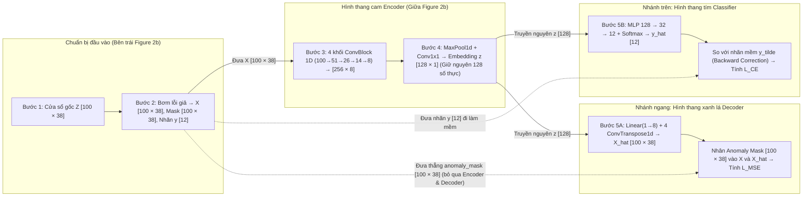
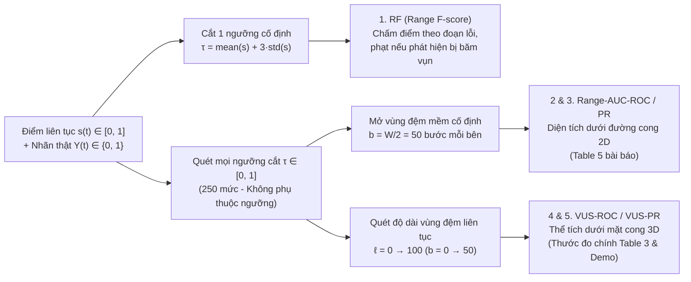

# Hướng Dẫn Từng Bước Luồng Tính Toán & Đánh Giá Của Mô Hình `ConvAEC` (REDLAMP — KDD '25)

Tài liệu này diễn giải chi tiết **từng phép nhân – cộng – biến đổi kích thước mảng** bên trong kiến trúc **`ConvAEC`** của REDLAMP cho tới **bước chấm điểm đánh giá chất lượng (`RF`, `Range-AUC`, `VUS-ROC`, `VUS-PR`, `Acc`)** thông qua các ví dụ tính nhẩm cụ thể trên bộ dữ liệu **`SMD`**, ánh xạ trực tiếp **1–1** với **Figure 2(b)**, **Table 3 & Table 5** trong bài báo gốc (`2505.20765v1.pdf`) và mã nguồn thực tế (`RedLamp/loaders/loader_aug.py`, `RedLamp/models/cnn.py`, `RedLamp/models/meta.py`, `RedLamp/models/classifier.py`, `RedLamp/evaluate.py`).

---

## 0. Bức Tranh Tổng Quan — Nhìn Hình Hiểu Ngay `ConvAEC` & Vị Trí Của `Anomaly Mask`

Trước khi đi vào từng phép nhân chi tiết, hãy nhìn **2 sơ đồ tổng quan** dưới đây (minh họa rút gọn cửa sổ thành **4 giây** trên 1 cảm biến để dễ theo dõi bằng mắt thường; thực tế trên `SMD` là **`100 giây × 38 cảm biến`**).

### 0.1. Luồng Huấn Luyện (`TRAIN`) — Đầy đủ phép tính từ Đầu vào ──► `Encoder` ──► `Decoder (Mask)` & `Classifier`

```text
╔══════════════════════════════════════════════════════════════════════════════════════════════════════════╗
║ [CHẶNG 0] CHUẨN BỊ DỮ LIỆU TỰ GIÁM SÁT (Trước khi vào mạng — thực hiện trong loader_aug.py)              ║
║                                                                                                          ║
║   Cửa sổ gốc sạch Z [100×38]:  ví dụ 4 giây kênh D1 = [0.20,  0.20,  0.20,  0.20]                        ║
║         │                                                                                                ║
║         ├──► (1) Bơm gai lỗi Spike (+0.80) vào giây thứ 3:                                               ║
║         │        Đầu vào X [100×38]      = [0.20,  0.20,  1.00,  0.20]  ──► Đưa thẳng vào ENCODER        ║
║         │                                                                                                ║
║         ├──► (2) Ghi sổ tờ mặt nạ đánh dấu chỗ vừa bơm lỗi (1 = giữ nguyên, 0 = chỗ vừa bơm lỗi):        ║
║         │        anomaly_mask [100×38]   = [  1 ,    1 ,    0 ,    1 ]  ──► Cất riêng, ĐỢI cuối DECODER! ║
║         │                                                                                                ║
║         └──► (3) Nhãn One-Hot y = [0, 1, 0..0] ──► Làm mềm Backward Correction (α=0.10, β=0.01):         ║
║                  y_tilde [12 lớp]        = [0.11 (Normal), 0.79 (Spike), 0.01, ..., 0.01]                ║
╚════════════════════════════════════════════════════╤═════════════════════════════════════════════════════╝
                                                     │
                                                     ▼  Đưa trọn vẹn X = [0.20, 0.20, 1.00, 0.20] vào mạng
┌──────────────────────────────────────────────────────────────────────────────────────────────────────────┐
│ [CHẶNG 1] THÂN CHUNG: CONV-ENCODER (models/cnn.py -> ConvEncoder) — Nén cửa sổ [100×38] về [128×1]       │
│                                                                                                          │
│  1) Đảo trục để trượt theo thời gian: [100 bước × 38 kênh] ──► [38 kênh × 100 bước]                      │
│                                                                                                          │
│  2) Đi qua 4 khối ConvBlock 1D nối tiếp (kernel k=4, stride s=2, pad p=2 => T_mới = ⌊T_cũ/2⌋ + 1):       │
│     Kích thước: [38×100] ──► Khối 0:[128×51] ──► Khối 1:[128×26] ──► Khối 2:[256×14] ──► Khối 3:[256×8]  │
│                                                                                                          │
│     * Phép tính cụ thể bên trong 1 khối (ví dụ Bộ lọc #1 dò gai [-1, -1, +3, -1] trượt trên X):          │
│       (a) Conv1d (Nhân-cộng cửa sổ 4 bước, nhảy s=2 bước/lần):                                           │
│           • Đoạn phẳng [0.20, 0.20, 0.20, 0.20]: 0.2(-1) + 0.2(-1) + 0.2(+3) + 0.2(-1) =  0.00           │
│           • Trúng gai  [0.20, 0.20, 1.00, 0.20]: 0.2(-1) + 0.2(-1) + 1.0(+3) + 0.2(-1) = +2.40 (bắt gai!)│
│           ──► Dãy tích chập thô:               [+0.40, -0.80, +2.40,  0.00,  0.00, ...]                  │
│       (b) BatchNorm1d — Chuẩn hóa (x - μ)/σ về trung bình 0, phương sai 1:                               │
│           ──► Sau chuẩn hóa biên độ:           [ 0.00, -1.20, +2.00, -0.40, -0.40, ...]                  │
│       (c) ReLU — Hàm max(0, x) giữ số dương, cắt toàn bộ số âm về 0:                                     │
│           ──► Chỉ còn điểm gai dương nổi bật:  [ 0.00,  0.00, +2.00,  0.00,  0.00, ...]                  │
│       (d) Dropout(0.2) (chỉ bật lúc Train) — Tắt ngẫu nhiên 20% về 0, số còn lại nhân bù ×1.25:          │
│           ──► Đầu ra khối tích chập:           [ 0.00,  0.00, +2.50,  0.00,  0.00, ...]                  │
│                                                                                                          │
│  3) Global MaxPool1d (kernel=8): Quét hết 8 mốc thời gian còn lại trên từng kênh, lấy 1 số lớn nhất:     │
│     • Kênh #1: max([0.00, +2.50, 0.10, 0.00, 0.05, 0.00, 0.00, 0.00]) = +2.50                            │
│     • Làm trên cả 256 kênh: [256 × 8] ──► [256 × 1]  (trục thời gian nén gọn về đúng 1!)                 │
│                                                                                                          │
│  4) Conv1x1 (256 ──► 128, KHÔNG có ReLU): Nhân ma trận trọng số [128×256] với cột [256×1]                │
│     • Ví dụ: z_0 = w_{0,0}·(+2.50) + ... + b_0 = -0.85 ;  z_1 = +2.41 ; ...                              │
│     • Kết quả: [256 × 1] ──► [128 × 1] (mang cả dấu Âm và Dương vì tầng cuối không cắt ReLU)             │
└────────────────────────────────────────────────────┬─────────────────────────────────────────────────────┘
                                                     │
                                                     ▼
                      ╔══════════════════════════════════════════════════════════════╗
                      ║ [CHẶNG 2] NÚT CỔ CHAI: EMBEDDING z [128 × 1]                 ║
                      ║   z = [-0.85, +2.41, -0.12, ..., +5.10]  (128 số thực)       ║
                      ║   [!] KHÔNG HỀ CÓ MASK Ở ĐÂY!                                ║
                      ║   Giữ nguyên 100% cả 128 số thực để chia cho 2 nhánh chữ Y!  ║
                      ╚══════════════╤════════════════════════════════╤══════════════╝
                                     │                                │
             ┌───────────────────────┘                                └───────────────────────┐
             ▼ (Nhánh 1: Khôi phục sóng chuẩn)                                                ▼ (Nhánh 2: Chẩn đoán 12 lớp)
┌─────────────────────────────────────────────────────┐          ┌─────────────────────────────────────────────────────┐
│ [CHẶNG 3A] CONV-DECODER (Giải nén ngược về 100×38)  │          │ [CHẶNG 3B] CLASSIFIER (MLP 2 tầng phân loại)        │
│  1) Linear(1→8): kéo dãn [128×1] ──► [128×8]        │          │  1) Linear(128→32) ──► BatchNorm1d ──► ReLU         │
│  2) 4 khối ConvTranspose1d (nhân ngược + BN + ReLU):│          │     ──► Dropout(0.2) ──► Linear(32→12) (12 điểm thô)│
│     [128×8]→[256×14]→[256×26]→[128×51]→[128×100]    │          │  2) Softmax: p_i = e^(u_i) / ∑ e^(u_j) (tổng = 1.0) │
│  3) Conv1x1(128→38) + đảo trục ──► X_hat [100×38]   │          │     ──► Ra xác suất y_hat [12 lớp]                  │
└──────────────────────────┬──────────────────────────┘          └──────────────────────────┬──────────────────────────┘
                           │                                                                │
                           ▼ Vẽ lại đường êm chuẩn (bỏ qua gai):                            ▼ Đoán trúng hình dạng lỗi:
              X_hat = [0.21, 0.20, 0.22, 0.20]                                 y_hat = [0.10 Normal, 0.80 Spike, ...]
                           │                                                                │
                           ▼                                                                ▼
╔═════════════════════════════════════════════════════╗          ╔═════════════════════════════════════════════════════╗
║ [CHẶNG 4A] CHỐT CHẶN ANOMALY MASK (Tính Loss L_MSE) ║          ║ [CHẶNG 4B] ĐỐI CHIẾU NHÃN MỀM (Tính Loss L_CE)      ║
║ Lấy tờ anomaly_mask = [1, 1, 0, 1] nhân vào CẢ HAI: ║          ║ So khớp y_hat với nhãn mềm y_tilde [0.11, 0.79,...]:║
║  • X     * mask: [0.20, 0.20, 1.00, 0.20]*[1,1,0,1] ║          ║  L_CE = -∑ y_tilde_i · ln(y_hat_i)                  ║
║                = [0.20, 0.20,  0  , 0.20]           ║          ║       = -(0.11·ln 0.10 + 0.79·ln 0.80 + ...) ≈ 1.65 ║
║  • X_hat * mask: [0.21, 0.20, 0.22, 0.20]*[1,1,0,1] ║          ╚══════════════════════════╤══════════════════════════╝
║                = [0.21, 0.20,  0  , 0.20]           ║                                     │
║  • Giây 1: (0.20 - 0.21)² = 0.0001 (chấm ô chuẩn)   ║                                     │
║  • Giây 3: (  0  -   0  )² = 0     (KHÔNG PHẠT!)    ║                                     │
║  ──► L_MSE trung bình cực nhỏ ≈ 0.0002              ║                                     │
╚══════════════════════════╤══════════════════════════╝                                     │
                           └──────────────────────────┐          ┌──────────────────────────┘
                                                      ▼          ▼
                                    [CHẶNG 5] TỔNG HỢP LOSS & CẬP NHẬT TRỌNG SỐ
                                    L = 0.9·L_MSE + 0.1·L_CE = 0.9(0.0002) + 0.1(1.65) = 0.16518
                                    ──► Lan truyền ngược (AdamW) tinh chỉnh bộ lọc cho bước kế tiếp!
```

---

### 0.2. Luồng Kiểm Thử & Dự Đoán Thực Tế (`TEST / LIVE DEMO`) — Tắt `Dropout` & Tháo bỏ `Mask` để bắt lỗi!

Khi mang mô hình đã nạp `bestmodel.pkl` ra chạy thực tế (hoặc bấm trên **Web Demo**), dữ liệu đi vào là cảm biến thật **chưa biết chỗ nào có lỗi**, nên **KHÔNG bơm lỗi giả**, **TẮT `Dropout` trong Encoder/Decoder/Classifier**, và **KHÔNG che `Anomaly Mask`** (mở `Mask = 1` toàn bộ `100×38` ô):

```text
Tín hiệu thực tế X = [0.20, 0.20, 1.00 (Sự cố thật!), 0.20]
                              │
                              ▼
         ┌─────────────────────────────────────────┐
         │ ENCODER (chế độ eval: TẮT Dropout)      │
         │ 4 ConvBlock (100→51→26→14→8)            │
         │ ──► MaxPool1d(8→1) ──► Conv1x1(256→128) │
         └────────────────────┬────────────────────┘
                              │
                              ▼  Embedding z [128 số thực] (lệch mạnh khỏi vùng chuẩn 0)
              ┌───────────────┴───────────────────────────────┐
              ▼                                               ▼
   DECODER (1→8→14→26→51→100)                      CLASSIFIER (128→32→12 + Softmax)
   (Do lúc Train được Mask bảo vệ                  (Nhận diện hình thái sóng đang
    nên chỉ biết vẽ lại sóng chuẩn!)                giống lớp lỗi giả nào nhất)
              │                                               │
              ▼                                               ▼
   X_hat = [0.21, 0.20, 0.22, 0.20]                Dự đoán: 99% thuộc lớp "Spike"
              │                                    + Lọc FAA: gạch về 0 các lớp > 5% chuỗi
              ▼                                               │
   KHÔNG CHE MASK (tính đủ 100% các ô):                       ▼
   Tại giây 3: (1.00 - 0.22)² = 0.6084!            Điểm phân loại s_CE = ∑ p_lỗi_hợp_lệ ≈ 0.99
   ──► Điểm tái tạo s_MSE VỌT GẤP 6000×!                      │
              │                                               │
              └───────────────┬───────────────────────────────┘
                              ▼
             ĐIỂM BẤT THƯỜNG KẾT HỢP (Combined Score)
             • Cửa sổ đơn (Tab 2 & Tab 3 Demo): Raw Combined = (s_MSE + s_CE) / 2  so với  μ + 3σ
             • Toàn chuỗi (Tab 1 & Chấm điểm):  s(t) = 0.5·MinMax(MA_50(s_MSE)) + 0.5·MinMax(MA_50(s_CE))
             ──► VƯỢT NGƯỠNG ──► BÁO ĐỘNG BẤT THƯỜNG!
```

> [!IMPORTANT]
> **3 điểm cốt lõi cần nhớ để không bao giờ nhầm về `Anomaly Mask`:**
> 1. **Mask che ở đâu?** Mask **KHÔNG** che ở `Encoder` và **KHÔNG** biến đổi `128` đặc trưng ẩn `z` thành `0/1`. Vector `z` (`[128 × 1]`) luôn là `128` số thực giữ nguyên vẹn. Mask có kích thước bằng đúng cửa sổ thời gian (`[100 × 38]`) và **chỉ nhân ở bước cuối cùng sau `Decoder`** khi tính `L_MSE`.
> 2. **Ai tạo ra số `0` và `1` trong Mask?** Không phải mạng AI tự suy ra. Lúc `Train`, chính đoạn code tạo dữ liệu giả (`loader_aug.py`) tự chọn vị trí để chèn lỗi nên nó biết sẵn ô nào vừa bị sửa để ghi số `0` (che đi), ô nào giữ nguyên để ghi số `1` (giữ lại).
> 3. **Tại sao trên Web Demo (Tab 2 – Bước 3 Decoder) lại có khái niệm Bật/Tắt Mask?** Mặc định lúc chạy `Test` là **Tắt Mask** (mở `1` toàn bộ `3,800` ô) để lộ vùng sai lệch đỏ `|X - X_hat|` giúp bắt lỗi; còn khi **Bật Mask** trên Demo là để **mô phỏng lại góc nhìn lúc `Train`** — cho người xem thấy nếu che các ô vượt chuẩn bằng `0` thì `MSE` lập tức sụt về gần `0`, giải thích vì sao `Decoder` không học vẹt gai nhiễu.

---

## 1. Phân Cấp Dữ Liệu & Giải Trừ Các Hiểu Nhầm Dễ Gặp

### 1.1. Phân biệt rõ: `Dataset` vs. `Entity (Machine)` vs. `Channel (Kênh)`
Trên bộ dữ liệu máy chủ **`SMD`**, ba khái niệm này nằm ở các cấp độ hoàn toàn khác nhau:

> **Tập dữ liệu (`SMD`)** $\supset$ **28 Thực thể / Máy chủ (`machine-1-1` .. `machine-3-11`)** $\supset$ Mỗi máy có **38 Kênh đầu vào (`D1..D38`)** $\xrightarrow{\text{qua Conv1d}}$ biến thành **128 rồi 256 Kênh đặc trưng ẩn**.

* **`1 machine` (ví dụ `machine-1-1`) = `1 Thực thể (Entity)`:** Là 1 máy chủ độc lập, được huấn luyện thành **1 tệp trọng số `bestmodel.pkl` riêng biệt**.
* **`Kênh đầu vào` (`in_channels = 38`):** Nằm **bên trong 1 máy `machine-1-1`**. Mỗi cột cảm biến là 1 kênh đầu vào (`D1` = `% CPU`, `D2` = `% RAM`, ..., `D38` = `Network Out`), tương tự như 1 bức ảnh màu có 3 kênh Đỏ – Lục – Lam (`RGB`).
* **`Kênh ẩn` (`out_channels = 128` $\rightarrow$ `256`):** Khi cửa sổ đi qua tầng tích chập có 128 bộ lọc, mỗi bộ lọc ôm trọn cả 38 cảm biến để dò một kiểu hình thái riêng (dò gai nhọn, dò sườn dốc, dò nhiễu...) và xuất ra 1 dãy số kết quả $\rightarrow$ tạo thành **128 kênh ẩn**, rồi tăng lên **256 kênh ẩn** ở các tầng sâu hơn.
* *(Lưu ý: Riêng ở hai bộ dữ liệu tàu vũ trụ NASA là `SMAP` và `MSL`, tài liệu gốc tiếng Anh của NASA đôi khi gọi từng thực thể `P-1`, `M-1` là "telemetry channel"; trên Web Demo và trong code đánh giá, nhóm gọi thống nhất cấp độ đó là **`Entity` / Thực thể**).*

### 1.2. Bảng đối chiếu nhanh các khái niệm dễ nhầm khi vấn đáp

| Khái niệm dễ hiểu nhầm | Thực tế chính xác trong code `ConvAEC` |
| :--- | :--- |
| *"`38` đặc trưng của `SMD` được đổi sang One-Hot Encoding"* | **Không phải.** `38` đặc trưng vốn đã là **số thực liên tục** chuẩn hóa Min-Max về `[0, 1]` nên đi thẳng vào mạng. **One-Hot Encoding** chỉ dùng cho **nhãn phân loại `12` lớp** (`y = [0, 1, 0, ..., 0]`). |
| *"`[128, 128, 256, 256]` là 4 bộ lọc"* | Đây là **4 tầng tích chập (`ConvBlock`) xếp nối tiếp nhau**: Tầng 1 có **128 bộ lọc**, Tầng 2 có **128 bộ lọc**, Tầng 3 có **256 bộ lọc**, Tầng 4 có **256 bộ lọc**. |
| *"Bộ lọc có kích thước `4×4` như xử lý ảnh"* | **Không phải `4×4` (`2D-CNN`).** Đây là **`1D-CNN`** với `kernel_size = 4` bước thời gian. Ở Tầng 1, mỗi bộ lọc có kích thước thực là **`4 bước thời gian × 38 đặc trưng`**, chỉ trượt dọc theo **1 chiều duy nhất là trục thời gian** với bước nhảy `stride = 2`. |
| *"`BatchNorm1d` dùng để gom/in gói batch"* | Việc chia dữ liệu thành từng gói (*batch*) là của `DataLoader`. Còn **`BatchNorm1d`** chuẩn hóa các con số bên trong mạng về **trung bình $\approx 0$, độ lệch chuẩn $\approx 1$** để số không bị phình quá lớn hay teo quá nhỏ qua nhiều tầng nhân. |
| *"`ReLU` làm nhiệm vụ gì?"* | Công thức $\text{ReLU}(x) = \max(0, x)$: **số dương giữ nguyên, số âm biến thành `0`**. Giúp loại bỏ tín hiệu âm không khớp bộ lọc và tạo **tính phi tuyến** để mạng học được quy luật sóng phức tạp. |
| *"`Dropout = 0.2` cắt ngắn mảng đi 20%"* | Mảng **giữ nguyên kích thước**, nhưng ngẫu nhiên **tắt 20% vị trí về `0`** (và nhân bù các số còn lại lên `1 / 0.8 = 1.25`). **Chỉ bật lúc `Train`** để chống **`Overfitting`**, **tắt hoàn toàn lúc `Test / Demo`**. |
| *"`Conv1x1` ở cuối Encoder trả thẳng về 12 lớp"* | **Chưa phân loại.** `Conv1x1` chỉ gom `256` kênh xuống **`Bottleneck` `128` chiều (`Embedding`)**. Từ `128` số này mạng mới **rẽ làm 2 nhánh chữ Y**: `Decoder` (`Reconstruction`) và `Classifier` (12 lớp). |
| *"`Anomaly Mask` che hoặc biến `128` đặc trưng ẩn `z` sau `Encoder` thành `[0, 0, 0, 1]`"* | **Không phải.** `128` số của `Embedding z` là **số thực âm/dương giữ nguyên 100%** để cấp cho cả `Decoder` lẫn `Classifier`. `Anomaly Mask` có kích thước bằng cửa sổ gốc **`[100 × 38]`** (sinh sẵn lúc chèn lỗi giả: `1` = ô chuẩn, `0` = ô chèn lỗi) và **chỉ nhân ở cuối cùng sau `Decoder`** khi tính `L_MSE` lúc `Train`. |
| *"`Bước trượt 10 (Train) · 1 (Test)` giống `stride = 2` của CNN"* | **Khác hẳn cấp độ.** `Bước trượt 10 / 1` là khoảng cách kéo khung lớn `W = 100` trên chuỗi dữ liệu dài để **cắt mẫu cửa sổ** (Train nhảy `10` bước `[0..99] → [10..109]` để giảm trùng lặp 99% và nhanh gấp 10×; Test nhích từng `1` bước `[0..99] → [1..100]` để chấm mọi giây). Còn `stride = 2` là bước nhảy của bộ lọc nhỏ `k = 4` **bên trong** 1 cửa sổ 100 điểm. |

---

## 2. Ánh Xạ 1–1 Giữa Các Bước Tính Toán Và Hình **Figure 2(b)** Trong Bài Báo

Sơ đồ dưới đây mô tả chính xác luồng biến đổi kích thước dữ liệu của **1 cửa sổ `SMD`** và vị trí tương ứng của từng bước trên hình **Figure 2(b) — Model architecture** (trang 4, `2505.20765v1.pdf`):



| Bước tính toán | Vị trí trên **Figure 2(b)** (`2505.20765v1.pdf`, tr. 4) | Vai trò cốt lõi |
| :--- | :--- | :--- |
| **Bước 1 + Bước 2** | • Ô **`Augmented instance`** *(bên trái cùng, có vệt đỏ `Inserted anomaly`)*<br>• Biểu đồ cột **`One-hot label`** *(góc trên trái)*<br>• Ô đen trắng **`Anomaly mask`** *(góc phải)* | Chuẩn bị nguyên liệu đầu vào trước khi đưa vào mạng (tạo dữ liệu giả bất thường tự giám sát từ chuỗi huấn luyện). |
| **Bước 3 + Bước 4** | • **Hình thang màu cam `Encoder`**<br>• **Thanh dọc chấm tròn `Embedding`** | **Chính là khối `Encoder`:** nén chiều thời gian từ `100` bước về `1` cột dọc **`Embedding` gồm `128` con số**. |
| **Bước 5 — Nhánh 1** | • **Hình thang màu xanh lá `Decoder`** $\rightarrow$ **`Reconstruction`** $\leftrightarrow$ **`L_MSE`** $\leftrightarrow$ **`Masked input`** | Giải nén từ `128` số ra lại cửa sổ `100 × 38`; dùng **`Anomaly Mask`** loại bỏ vùng lỗi giả khỏi hàm loss để chỉ học tái tạo vùng bình thường. |
| **Bước 5 — Nhánh 2** | • **Hình thang màu tím `Classifier`** $\rightarrow$ **`Predicted label`** $\leftrightarrow$ **`L_CE`** $\leftrightarrow$ **`Corrected label`** *(mũi tên `Backward correction` trên cùng)* | Phân loại `128` số vào 12 lớp và đối chiếu với **`Soft Label` (`Backward Correction`)** để chống `Anomaly Contamination` và `False Anomaly`. |

---

## 3. Ví Dụ Tính Tay Chi Tiết Từng Bước (Trên 1 Cửa Sổ `SMD`)

Xét **1 cửa sổ của thực thể `SMD / machine-1-1`** dài `W = 100` mốc thời gian (`t = 0..99`), gồm `D = 38` kênh cảm biến (`D1..D38`). Để dễ nhẩm bằng tay, ta theo dõi trực tiếp kênh đầu tiên **`D1` (`% CPU`)** tại các giây đầu `t = 0..5` (các kênh `D2..D38` được tính song song và cộng dồn hoàn toàn tương tự).

---

### Bước 1: Cắt cửa sổ 100 bước thời gian gốc (`Z`)
Giả sử máy chủ đang hoạt động bình thường ổn định ở mức CPU `20%` (sau chuẩn hóa Min-Max về đoạn `[0, 1]` có giá trị `0.20`).
Ta cắt được bảng gốc `Z` kích thước **`100 dòng × 38 cột`** (`3,800` con số):

| Thời gian `t` | `t=0` | `t=1` | `t=2` | `t=3` | `t=4` | `t=5` | ... `t=99` |
| :--- | :---: | :---: | :---: | :---: | :---: | :---: | :---: |
| **`D1` gốc (`Z`)** | `0.20` | `0.20` | `0.20` | `0.20` | `0.20` | `0.20` | `0.20` |

---

### Bước 2: Chèn 1 lỗi giả `Spike` (Gai nhọn — Lớp số `1`)
Hàm `_inject_spike` trong `RedLamp/loaders/loader_aug.py` chọn ngẫu nhiên thời điểm **`t = 3`** trên kênh **`D1`** và cộng thêm một xung nhọn `+0.80`:
* Giá trị tại `(t=3, D1)` nhảy vọt từ `0.20` lên: `0.20 + 0.80 = 1.00`.
* Đồng thời sinh ra **2 thông tin giám sát đi kèm**:
  1. **Mặt nạ `anomaly_mask` (`100 × 38`):** Trong code PyTorch (`loader_aug.py`, dòng 157 & 169), các ô bình thường mang giá trị **`1`**, riêng ô bị chèn lỗi `(t=3, D1)` mang giá trị **`0`**.
     *(Ghi chú đọc bài báo: Phương trình (2) trong bài báo ký hiệu ngược lại $W = 1$ tại điểm lỗi rồi nhân với $(1 - W) = 0$; cả hai cách viết đều cho kết quả toán học giống hệt nhau là nhân `0` tại điểm chèn lỗi).*
  2. **Nhãn One-Hot `y` (`12` phần tử):** Lớp `0` là `Normal`, lớp `1` là `Spike` $\rightarrow$ `y = [0, 1, 0, 0, 0, 0, 0, 0, 0, 0, 0, 0]`.

| Thời gian `t` | `t=0` | `t=1` | `t=2` | **`t=3` (Chèn Spike)** | `t=4` | `t=5` | ... `t=99` |
| :--- | :---: | :---: | :---: | :---: | :---: | :---: | :---: |
| **Đầu vào `X` (`D1`)** | `0.20` | `0.20` | `0.20` | **`1.00`** | `0.20` | `0.20` | `0.20` |
| **`anomaly_mask` (`D1`)** | `1` | `1` | `1` | **`0`** | `1` | `1` | `1` |

---

### Bước 3: Đi qua 4 tầng của `ConvEncoder` (Nhân – Cộng – BatchNorm – ReLU – Dropout)
Theo `RedLamp/main.py` (dòng 23–29), mỗi khối `ConvBlock` có cấu hình: **`kernel_size = 4`**, **`stride = 2`**, **`padding = 2`** (đệm thêm 2 số `0` ở đầu và 2 số `0` ở cuối trục thời gian).

#### 3.1. Công thức co ngắn chiều thời gian qua 4 tầng (`100 → 51 → 26 → 14 → 8`)
Số bước thời gian đầu ra sau mỗi tầng tích chập 1D được tính bằng công thức:

$$L_{\text{out}} = \left\lfloor \frac{L_{\text{in}} + 2 \times \text{padding} - \text{kernel\_size}}{\text{stride}} \right\rfloor + 1 = \left\lfloor \frac{L_{\text{in}} + 2 \times 2 - 4}{2} \right\rfloor + 1 = \left\lfloor \frac{L_{\text{in}}}{2} \right\rfloor + 1$$

* **Tầng 1 (`38 → 128` bộ lọc):** $\lfloor 100 / 2 \rfloor + 1 = \mathbf{51}$ $\rightarrow$ xuất bảng `[128 × 51]`
* **Tầng 2 (`128 → 128` bộ lọc):** $\lfloor 51 / 2 \rfloor + 1 = \mathbf{26}$ $\rightarrow$ xuất bảng `[128 × 26]`
* **Tầng 3 (`128 → 256` bộ lọc):** $\lfloor 26 / 2 \rfloor + 1 = \mathbf{14}$ $\rightarrow$ xuất bảng `[256 × 14]`
* **Tầng 4 (`256 → 256` bộ lọc):** $\lfloor 14 / 2 \rfloor + 1 = \mathbf{8}$ $\rightarrow$ xuất bảng `[256 × 8]`

#### 3.2. Nhẩm tay phép nhân – cộng của 1 bộ lọc (ví dụ Bộ lọc #1 chuyên dò gai nhọn)
Giả sử Bộ lọc #1 trên kênh `D1` có 4 trọng số `[-1, -1, +3, -1]` (nếu gặp vùng phẳng 4 số bằng nhau thì tổng bằng `0`; nếu điểm thứ 3 vọt cao thì tổng dương rất lớn; giả sử trọng số trên `D2..D38` bằng `0` để nhẩm gọn):

* **Vị trí trượt 1** *(nhìn 4 ô gồm 2 số `0` đệm đầu + `t=0, 1`: `[0, 0, 0.20, 0.20]`)*:
  `(0)×(-1) + (0)×(-1) + (0.20)×(+3) + (0.20)×(-1) = +0.40`
* **Vị trí trượt 2** *(nhảy `stride = 2` bước sang `[0.20, 0.20, 0.20, 1.00]`)*:
  `(0.20)×(-1) + (0.20)×(-1) + (0.20)×(+3) + (1.00)×(-1) = -0.80`
* **Vị trí trượt 3** *(khi thước lọc chụp trúng gai nhọn ở vị trí `+3`, ví dụ `[0.20, 0.20, 1.00, 0.20]`)*:
  `(0.20)×(-1) + (0.20)×(-1) + (1.00)×(+3) + (0.20)×(-1) = -0.20 - 0.20 + 3.00 - 0.20 = +2.40` *(Phát hiện gai, giá trị vọt mạnh!)*
* **Vị trí trượt 4 & 5** *(trượt qua vùng phẳng `[0.20, 0.20, 0.20, 0.20]`)*:
  `(0.20)×(-1) + (0.20)×(-1) + (0.20)×(+3) + (0.20)×(-1) = 0.00`

Xét 5 giá trị đầu tiên của Bộ lọc #1: **`[+0.40, -0.80, +2.40, 0.00, 0.00]`**. Tiếp tục đi qua 3 phép biến đổi còn lại trong khối `ConvBlock`:
1. **`BatchNorm1d` (Chuẩn hóa biên độ):**
   * Trung bình $\mu = (0.40 - 0.80 + 2.40 + 0 + 0) / 5 = 0.40$; giả sử độ lệch chuẩn $\sigma = 1.00$.
   * Tính $(x - \mu) / \sigma$: **`[0.00, -1.20, +2.00, -0.40, -0.40]`**.
2. **`ReLU` (Giữ số dương, xóa số âm về `0`):**
   * Áp dụng $\max(0, x)$: **`[0.00, 0.00, +2.00, 0.00, 0.00]`** *(Mọi nhiễu âm bị dập tắt, chỉ còn điểm gai `+2.00` nổi bật)*.
3. **`Dropout = 0.2` (Chỉ hoạt động lúc `Train`):**
   * Mỗi vị trí có `20%` xác suất bị tắt về `0`; các vị trí còn lại được nhân bù `1 / (1 - 0.2) = 1.25`.
   * Giả sử vị trí `+2.00` không bị tắt: `2.00 × 1.25 = +2.50` $\rightarrow$ **`[0.00, 0.00, +2.50, 0.00, 0.00]`**.

Đi hết Tầng 4, toàn bộ cửa sổ được cô đọng thành ma trận **`[256 kênh × 8 mốc thời gian]`**.

---

### Bước 4: `MaxPool1d` và `Conv1x1` — Nén về `Bottleneck Embedding` (`128` chiều)
Tại cuối hàm `ConvEncoder.forward` (`RedLamp/models/cnn.py`, dòng 68–70):
1. **`Global MaxPool1d`:** Quét hết cả `8` mốc thời gian còn lại trên từng kênh để chọn ra **1 giá trị cực đại**:
   * Ví dụ Kênh #1 có 8 số `[0.00, 2.50, 0.10, 0.00, 0.05, 0.00, 0.00, 0.00]` $\rightarrow$ giữ lại **`2.50`**.
   * Thực hiện trên cả `256` kênh $\rightarrow$ thu được **`[256 × 1]`** (`256` con số).
2. **`Conv1x1`:** Nhân tổ hợp tuyến tính ma trận trọng số `128 × 256` với vector `256` số để nén xuống đúng **`Bottleneck` `Vector Embedding` gồm `128` chiều (`[128 × 1]`)**.

---

### Bước 5: Tách Ngã Ba Chữ **Y** — `Decoder`, `Classifier` & Tính Loss Khi Huấn Luyện (`Train`)

Từ cùng một **`Vector Embedding` (`128` chiều)**, mô hình rẽ làm **2 nhánh song song** (`RedLamp/models/meta.py`, dòng 33–62):

#### 5.1. Nhánh 1 — `ConvDecoder` & Reconstruction Loss có `Anomaly Mask` (`loss_ae` / $\mathcal{L}_{MSE}$)
`ConvDecoder` dùng tầng `Linear(1 → 8)` rồi 4 khối `Transposed Convolution` (`ConvTranspose1d`: `8 → 14 → 26 → 51 → 100`) để khôi phục `128` số về lại bảng dự đoán `X_hat` kích thước **`100 × 38`**.
Vì `Bottleneck` chỉ lưu giữ quy luật bình thường, mạng tái tạo kênh `D1` mượt quanh `0.20–0.22` (kể cả ngay tại `t=3`):

| Thời gian `t` | `t=0` | `t=1` | `t=2` | **`t=3` (Vị trí chèn Spike)** | `t=4` |
| :--- | :---: | :---: | :---: | :---: | :---: |
| **Đầu vào `X`** | `0.20` | `0.20` | `0.20` | **`1.00`** | `0.20` |
| **`Reconstruction` `X_hat`** | `0.21` | `0.20` | `0.21` | **`0.22`** | `0.20` |
| **`anomaly_mask`** | `1` | `1` | `1` | **`0`** | `1` |

Khi tính `loss_ae` lúc **Train**, code nhân `X * anomaly_mask` và `X_hat * anomaly_mask` trước khi tính bình phương sai số:
* Tại `t=0` (ô bình thường, `mask = 1`): $(0.20 \times 1 - 0.21 \times 1)^2 = (-0.01)^2 = \mathbf{0.0001}$.
* Tại **`t=3` (ô `Pseudo-Anomaly`, `mask = 0`)**: $(1.00 \times 0 - 0.22 \times 0)^2 = (0 - 0)^2 = \mathbf{0}$!
* **Ý nghĩa quyết định:** Nhờ `mask = 0`, mô hình **không bị phạt** khi dự đoán `0.22` thay vì `1.00`. Nhờ đó `Decoder` không bao giờ `Overfit` vào gai lỗi mà chỉ trung thành tái tạo hình thái bình thường. Giả sử trung bình toàn cửa sổ `loss_ae = 0.0002`.

#### 5.2. Nhánh 2 — `NonLinClassifier`, `Backward Correction` (`Soft Label`) & `loss_c` ($\mathcal{L}_{CE}$)
Vector `128` số đi qua mạng phân loại 2 tầng (`RedLamp/models/classifier.py`):
`Linear(128 → 32) → BatchNorm1d → ReLU → Dropout → Linear(32 → 12) → Softmax`, trả ra 12 xác suất có tổng bằng `1.00`:
* Giả sử dự đoán `y_hat = [0.10, 0.80, 0.01, 0.01, ..., 0.01]` *(đoán `80%` là lớp `1 - Spike`, `10%` là `0 - Normal`)*.
* **`Backward Correction` (`Soft Label` với $\alpha = 0.1, \beta = 0.01, K = 12$):**
  Vì trong `3,800` ô của cửa sổ có tới `3,799` ô vẫn bình thường (hoặc phòng trường hợp phép biến đổi vô tình tạo ra mẫu trông vẫn giống bình thường — `False Anomaly`), `One-Hot Label` `[0, 1, 0, ..., 0]` được hiệu chỉnh thành `Soft Label` `y_tilde` theo Phương trình (1):
  * Lớp `1` (`Spike`): $1 - 0.1 - 12 \times 0.01 + 0.01 = \mathbf{0.79}$
  * Lớp `0` (`Normal`): $0.01 + 0.1 = \mathbf{0.11}$ *(cộng xác suất $\alpha = 0.1$ về lớp bình thường)*
  * 10 lớp lỗi giả còn lại: mỗi lớp $\mathbf{0.01}$
  *(Kiểm tra tổng xác suất: $0.79 + 0.11 + 10 \times 0.01 = \mathbf{1.00}$)*.
* Đối chiếu `y_hat` với `y_tilde` qua hàm Cross-Entropy thu được `loss_c` (ví dụ `1.65`), sau đó cộng trọng số với `loss_ae` theo hệ số $\gamma = \text{c\_loss\_ratio}$:

$$\mathcal{L} = (1 - \gamma)\mathcal{L}_{MSE} + \gamma\mathcal{L}_{CE}$$

*(Với giá trị chuẩn Table 4 bài báo `c_loss_ratio = 0.10`: $\mathcal{L} = 0.9 \times 0.0002 + 0.1 \times 1.65 = \mathbf{0.16518}$).* Thuật toán tối ưu `AdamW` lan truyền ngược từ $\mathcal{L}$ để tinh chỉnh lại các bộ lọc, rồi trượt sang cửa sổ tiếp theo (`Step = 10`, tức `t = 10..109`).

---

### Bước 6: Khi Chạy Kiểm Thử & Trình Diễn Live Demo (`Test / Inference`) Khác Gì Khi `Train`?

Khi đưa một cửa sổ thực tế cần kiểm tra vào mô hình đã nạp `bestmodel.pkl` trên Web Demo (`Stride = 1`, trượt từng bước thời gian một):
1. **Không chèn lỗi giả, không có mặt nạ `W`, tắt hoàn toàn `Dropout`.**
2. **Điểm sai số tái tạo $s_{MSE}(t)$ — Phương trình (5):** Tính trực tiếp độ lệch giữa tín hiệu thực `X` và bản vẽ lại `X_hat`:
   * Tại điểm bình thường (`t=0`): $(0.20 - 0.21)^2 = \mathbf{0.0001}$ *(sai số cực thấp)*.
   * Tại điểm xảy ra sự cố thật (`t=3`): $(1.00 - 0.22)^2 = \mathbf{0.6084}$ *(sai số **vọt gấp hơn 6,000 lần** điểm bình thường!)*.
3. **Điểm phân loại hiệu chỉnh $s_{CE}(t)$ — Phương trình (6)–(7):** Cộng xác suất của 11 lớp bất thường ($i = 2..12$), nhưng nếu lớp giả bất thường nào xuất hiện tràn lan trên toàn chuỗi kiểm thử vượt ngưỡng $\delta = 0.05$ (*lớp giả bình thường — Pseudo-normal class*), bộ lọc **`FAA` (Frequent Anomaly Adjustment)** tự động gán điểm lớp đó về `0` để triệt tiêu báo động giả.
4. **Làm mượt `MA = 50` & Tổng hợp điểm bất thường cuối cùng $s(t)$ — Phương trình (8):** Trong `RedLamp/main.py` (`convolve_minmax_score`, dòng 258–303), cả hai dãy $s_{MSE}(t)$ và $s_{CE}(t)$ đều được làm mượt bằng trung bình trượt $w = W/2 = 50$ bước, chuẩn hóa Min-Max về $[0, 1]$ trên chuỗi kiểm thử rồi lấy trung bình cộng `50% - 50%` lưu thành tệp `anomaly_score.npy`:

$$s(t) = \frac{1}{2}\text{MinMax}_T\big(\text{MA}_{50}(s_{MSE}(t))\big) + \frac{1}{2}\text{MinMax}_T\big(\text{MA}_{50}(s_{CE}(t))\big) \in [0, 1]$$

---

## 4. Bước 7: Giải Phẫu Chi Tiết Các Chỉ Số Đánh Giá Chất Lượng (`RF`, `Range-AUC`, `VUS-ROC`, `VUS-PR`, `Acc`)

Sau Bước 6, ta đã có mảng điểm liên tục **`s = [s(0), s(1), ..., s(N-1)]`** (`anomaly_score.npy`, mỗi số nằm trong `[0, 1]`) và mảng nhãn sự thật mặt đất **`Y = [y(0), y(1), ..., y(N-1)]`** (`0` = bình thường, `1` = sự cố thật). Mục này giải thích **từng phép tính** bên trong tệp `RedLamp/evaluate.py` (kế thừa chuẩn thư viện `TSB-AD` / `vus` được bài báo KDD '25 trích dẫn tại Mục 4.1.3, Table 3 & Table 5).

### 4.1. Tiền xử lý trước khi chấm điểm: Căn lề tâm cửa sổ (`alignment = 'centre'`)
Một chuỗi kiểm thử dài $T$ bước thời gian khi cắt thành các cửa sổ trượt độ dài $W = 100$ (`Stride = 1`) sẽ sinh ra $N = T - W + 1$ cửa sổ:
* Cửa sổ thứ $i$ bao phủ đoạn thời gian $[i, \; i + 99]$.
* Theo chuẩn đánh giá `TSB-UAD` / `VUS` (`RedLamp/evaluate.py`, dòng 8–10 & 79–88, protocol `paper`), điểm bất thường của cửa sổ thứ $i$ được **gán vào mốc thời gian chính giữa cửa sổ** (`off = W // 2 = 50`, tức so khớp với nhãn `labels[50 : 50 + N]`), giúp tâm phản ứng của cửa sổ trượt khớp chính xác với tâm đoạn lỗi thực tế.

---

### 4.2. Tại sao KDD '25 loại bỏ `Accuracy` cổ điển và `F1-PA` (*Point Adjustment*)?

Xét một chuỗi kiểm thử ngắn gồm **10 giây** (`t = 0..9`), trong đó sự cố thật kéo dài **4 giây liên tiếp** từ `t = 4` đến `t = 7`:
* **Nhãn thật `Y`:** `[0, 0, 0, 0, 1, 1, 1, 1, 0, 0]`

Hai cách chấm điểm cũ đều gây sai lệch nghiêm trọng:
1. **Bẫy mất cân bằng của `Accuracy` cổ điển:** Trên tập `UCR`, lỗi chỉ chiếm trung bình `0.85%` thời gian (`99.15%` là `0`). Một mô hình "hỏng hoàn toàn" luôn đoán `0` ở mọi giây vẫn đạt `Accuracy = 99.15%` dù bỏ lọt 100% sự cố!
2. **Ảo tưởng điểm cao của `F1-PA` (*Point Adjustment*):** Quy tắc `PA` cũ cho phép: *"Chỉ cần dự đoán chạm trúng **1 điểm duy nhất** trong đoạn lỗi thật thì tự động sửa cả đoạn đó thành đoán đúng hết!"*.
   * Giả sử mô hình dự đoán rất tệ, chỉ bật `1` ngẫu nhiên tại đúng `t = 5`:
     * Dự đoán thực tế $\hat{Y}$: `[0, 0, 0, 0, 0, 1, 0, 0, 0, 0]` $\rightarrow$ Chấm theo điểm thực tế: bắt được `1/4` giây lỗi (`Recall = 25%`, `Precision = 100%` $\implies$ `Point-F1 = 0.400`).
     * Sau khi qua phép "phù phép" `PA`: `[0, 0, 0, 0, 1, 1, 1, 1, 0, 0]` $\rightarrow$ Biến thành bắt trúng `4/4` giây (`Recall = 100%` $\implies$ **`F1-PA = 1.000` tuyệt đối**!).
   * Vì vậy, bài báo KDD '25 khẳng định `F1-PA` đánh giá quá ảo (*overestimates model performance*) và chuyển hoàn toàn sang **bộ 5 thước đo theo phân đoạn (Range-based metrics)** dưới đây.

---

### 4.3. Sơ đồ tiến hóa của các thước đo trong `RedLamp/evaluate.py`



---

### 4.4. Chỉ số 1: `RF` — *Range F-score* (Tatbul et al., NeurIPS 2018)

`RF` là phiên bản nâng cấp của `F1-score` chấm trực tiếp trên **các đoạn thời gian liên tiếp (segments/ranges)** thay vì từng điểm rời rạc (`RedLamp/evaluate.py`, dòng 103–105).

#### Bước A — Cắt ngưỡng nhị phân tự động (`mean + 3·std`)
Để không "ăn gian" dò ngưỡng trên tập Test, giao thức chuẩn bài báo (`protocol = 'paper'`) chuyển điểm liên tục $s(t)$ thành nhãn dự đoán nhị phân $\hat{Y}(t) \in \{0, 1\}$ bằng quy tắc thống kê $3\sigma$:

$$\tau_{3\sigma} = \mu_s + 3\sigma_s \quad \Longrightarrow \quad \hat{Y}(t) = \begin{cases} 1, & \text{nếu } s(t) > \tau_{3\sigma}, \\ 0, & \text{ngược lại.} \end{cases}$$

*(Ghi chú: Trong `evaluate.py` dòng 105, nhóm cũng tính thêm cột đối chứng `RF (oracle)` lấy ngưỡng cho điểm cao nhất để tiện so sánh).*

#### Bước B — Tính `Range Recall` ($R_T$) và `Range Precision` ($P_T$)
Gọi $R = \{R_1, \dots, R_{N_r}\}$ là tập các đoạn lỗi thật và $\hat{R} = \{\hat{R}_1, \dots, \hat{R}_{N_p}\}$ là tập các đoạn mô hình báo lỗi:
1. **`Range Recall` của một đoạn lỗi thật $R_i$ (với trọng số $\alpha = 0.2$ trong chuẩn `VUS`/`TSB-AD`):**

$$R_T(R_i, \hat{R}) = \Big[\underbrace{\alpha \cdot \mathbb{I}(|R_i \cap \hat{R}| \ge 1)}_{\text{Thưởng phát hiện tồn tại }(20\%)} + \underbrace{(1 - \alpha) \cdot \frac{|R_i \cap \hat{R}|}{|R_i|}}_{\text{Tỷ lệ độ phủ kích thước }(80\%)}\Big] \times \underbrace{\gamma(R_i, \hat{R})}_{\text{Phạt băm vụn}}$$

   * **Thưởng tồn tại ($\alpha = 0.2$):** Hễ phát hiện chạm trúng đoạn sự cố là được thưởng trước `20%` điểm (vì đã kịp báo động cho kỹ sư).
   * **Thưởng độ phủ ($1 - \alpha = 0.8$):** `80%` điểm còn lại tính sòng phẳng theo tỷ lệ số giây bắt trúng trên tổng độ dài sự cố (chặn đứng trò gian lận của `F1-PA`!).
   * **Hệ số phạt băm vụn (*Cardinality factor* $\gamma$):** Nếu 1 sự cố liền mạch bị mô hình báo ngắt quãng thành $k > 1$ mảnh rời rạc, điểm bị chia phạt $\gamma = 1 / k$.
2. **`Range Precision` của một đoạn dự đoán $\hat{R}_j$:** Đo tỷ lệ phần trăm các bước trong đoạn báo động $\hat{R}_j$ thực sự nằm trùng trong lỗi thật: $P_T(\hat{R}_j, R) = |\hat{R}_j \cap R| / |\hat{R}_j|$.
3. **Tổng hợp `RF`:** Lấy trung bình $R_T$ trên mọi đoạn lỗi thật, trung bình $P_T$ trên mọi đoạn báo động, rồi tính trung bình điều hòa:

$$\text{RF} = \frac{2 \times P_T \times R_T}{P_T + R_T}$$

#### 🧮 Ví dụ tính nhẩm `RF` trong 15 giây
Giả sử chuỗi 10 giây có **1 đoạn lỗi thật** $R_1 = [4, 7]$ (dài `4` giây: `t = 4, 5, 6, 7`), và sau khi cắt ngưỡng $\tau_{3\sigma}$, mô hình báo **1 đoạn lỗi liền mạch** $\hat{R}_1 = [3, 5]$ (dài `3` giây: `t = 3, 4, 5` — tức báo sớm 1 giây ở `t=3` và bắt trúng 2 giây `t=4, 5`):
* Phần giao nhau $|R_1 \cap \hat{R}_1| = |\{4, 5\}| = \mathbf{2}$ giây; chỉ có $k = 1$ đoạn dự đoán chồng lên $R_1$ nên không bị phạt băm vụn ($\gamma = 1$).
* **`Range Recall`:** $R_T = \big[0.2 \times 1 + 0.8 \times \frac{2}{4}\big] \times 1 = 0.2 + 0.4 = \mathbf{0.600}$ (`60%`).
* **`Range Precision`:** Trong 3 giây mô hình hú còi (`t = 3, 4, 5`), có 2 giây đúng sự cố thật $\implies P_T = \frac{2}{3} \approx \mathbf{0.667}$ (`66.7%`).
* **Điểm `RF`:** $\text{RF} = \frac{2 \times 0.667 \times 0.600}{0.667 + 0.600} = \frac{0.800}{1.267} \approx \mathbf{0.632}$.

---

### 4.5. Chỉ số 2 & 3: `Range-AUC-ROC` & `Range-AUC-PR` (Table 5 bài báo)

Chỉ số `RF` ở trên vẫn phụ thuộc vào việc chọn ngưỡng $\tau_{3\sigma}$ và phạt oan điểm `t = 3` sát rìa sự cố (trong khi cửa sổ trượt $W=100$ rất hay tăng điểm sớm/trễ vài nhịp quanh biên sự cố). **`Range-AUC`** (Paparrizos et al., VLDB 2022) giải quyết triệt để cả hai vấn đề:

#### 1) Vùng đệm nhãn mềm (*Soft Buffer Region* $b = \ell / 2 = 50$ bước mỗi bên)
Thay vì nhãn nhị phân cứng `0 / 1` rơi thẳng đứng ở mép sự cố $[s, e]$, `Range-AUC` mở rộng ra hai phía đầu và đuôi đoạn lỗi một **vùng đệm dài $b = \ell / 2$ bước** (bài báo đặt $\ell = W = 100 \implies b = 50$ bước mỗi bên) với nhãn mềm $y_{\text{soft}}(t) \in [0, 1]$ giảm dần từ `1.0` tại mép lỗi về `0.0` ở cuối vùng đệm (theo hàm sườn dốc $(1 - d/b)^{1/2}$ với $d$ là khoảng cách tới mép lỗi):

| Thời gian `t` | `t=1` *(xa lỗi)* | `t=2` *(đệm $d=2$)* | `t=3` *(sát mép $d=1$)* | **`t=4..7` *(Đoạn lỗi thật)*** | `t=8` *(sát mép $d=1$)* | `t=9` *(đệm $d=2$)* | `t=10` *(xa lỗi)* |
| :--- | :---: | :---: | :---: | :---: | :---: | :---: | :---: |
| **Nhãn gốc `Y`** | `0` | `0` | `0` | **`1`** | `0` | `0` | `0` |
| **Nhãn đệm mềm $Y_{\text{soft}}$ ($b=3$)** | `0.00` | `0.58` | `0.82` | **`1.00`** | `0.82` | `0.58` | `0.00` |

* **Ý nghĩa trực quan:** Nếu mô hình báo động tại `t=3` hoặc `t=8` (ngay sát rìa sự cố), nó được ghi nhận `0.82` điểm `True Positive` mềm (và chỉ chịu `0.18` `False Positive`), thay vì bị kết tội báo động giả `100%` như cách chấm cũ! Ngược lại, nếu hú còi ở `t=1` (xa tít vùng đệm), nó bị phạt trọn `1.00` `False Positive`.

#### 2) Quét mọi ngưỡng cắt $\tau$ để tính diện tích dưới đường cong (`AUC`)
Hệ thống quét 250 mức ngưỡng $\tau$ từ `1.0` xuống `0.0`. Tại mỗi ngưỡng $\tau$, tính tỷ lệ bắt trúng theo đoạn **`Range-TPR` ($\text{Recall}_\tau$)**, tỷ lệ báo giả **`Range-FPR`**, và độ chính xác **`Range-Precision`**:
* Vẽ đường cong `Range-TPR` theo `Range-FPR` rồi tính diện tích bên dưới (quy tắc hình thang) $\rightarrow$ thu được **`Range-AUC-ROC`** (`R-R` trong Table 5).
* Vẽ đường cong `Range-Precision` theo `Range-Recall` rồi tính diện tích bên dưới $\rightarrow$ thu được **`Range-AUC-PR`** (`R-P` trong Table 5).

---

### 4.6. Chỉ số 4 & 5 (Thước đo chính trên Demo & Table 3): `VUS-ROC` & `VUS-PR` (*Volume Under the Surface*)

#### 1) Tại sao phải nâng cấp từ Diện tích 2D (`Range-AUC`) lên Thể tích 3D (`VUS`)?
Trong `Range-AUC`, ta phải tự ấn định độ dài vùng đệm $\ell = 100$ ($b = 50$). Nhưng mỗi bộ dữ liệu có nhịp điệu nhanh/chậm khác nhau: nếu chọn $\ell$ quá nhỏ thì khắt khe ở biên, chọn $\ell$ quá lớn thì lại dễ dãi với báo động giả quanh sự cố.

**`VUS` (*Volume Under the Surface*)** loại bỏ hoàn toàn tham số chủ quan này bằng cách **cho độ dài vùng đệm $\ell$ biến thiên liên tục từ $\ell = 0$ (không có vùng đệm) đến $\ell = L_{\max} = 100$** (`generate_curve(label, score, slidingWindow=100)` trong `RedLamp/evaluate.py`, dòng 16 & 102):
* Với **mỗi** độ dài vùng đệm $\ell \in \{0, 1, 2, \dots, 100\}$, ta dựng được 1 đường cong `ROC(ℓ)` và 1 đường cong `PR(ℓ)` trên mặt phẳng 2D.
* Xếp nối tiếp tất cả các đường cong đó dọc theo trục thứ ba là trục độ dài đệm $\ell$, ta thu được **một mặt cong 3 chiều (3D Surface)** trong không gian `(FPR, TPR, ℓ)` và `(Recall, Precision, ℓ)`:

```text
   Precision / TPR (0 → 1)
        ▲
    1.0 │      .---~~~~~~~---._          <-- Mặt cong 3D quét qua mọi ngưỡng τ
        │    .'   /       /    '-.            VÀ mọi độ dài vùng đệm ℓ = 0..100
        │   /    /       /        \
        │  /    /       /   THỂ    \     ℓ = 100 (đệm 50 bước mỗi bên)
        │ /    /       /   TÍCH     \   ↗
    0.0 └──────────────────────────────► Recall / FPR (0 → 1)
       ℓ = 0 (không đệm)
```

* **Công thức toán học tính `VUS-ROC` và `VUS-PR`:** Thể tích chuẩn hóa nằm dưới mặt cong 3D chính là **giá trị trung bình tích phân của `Range-AUC(ℓ)` trên toàn bộ dải vùng đệm $\ell \in [0, L_{\max}]$**:

$$\text{VUS-ROC} = \frac{1}{L_{\max}}\int_{0}^{L_{\max}} \text{Range-AUC-ROC}(\ell)\,d\ell, \qquad \text{VUS-PR} = \frac{1}{L_{\max}}\int_{0}^{L_{\max}} \text{Range-AUC-PR}(\ell)\,d\ell$$

#### 🧮 Ví dụ nhẩm tay cách ra con số `VUS-PR` và `VUS-ROC`
Xét thực thể `SMD / machine-1-1` (`Seed 0` trong `result/metrics_smd.csv`). Khi quét vùng đệm $\ell$ từ `0` đến `100`, giả sử ở 5 lát cắt đại diện $\ell \in \{0, 25, 50, 75, 100\}$ diện tích `Range-AUC` lần lượt là (trong đó mốc cuối $\ell = 100$ chính là hai cột `R-AUC-ROC = 0.9758` và `R-AUC-PR = 0.7869` trong tệp kết quả):

| Độ dài vùng đệm $\ell$ *(mỗi bên $b = \ell/2$)* | $\ell = 0$ *(0 bước)* | $\ell = 25$ *(12 bước)* | $\ell = 50$ *(25 bước)* | $\ell = 75$ *(37 bước)* | $\ell = 100$ *(50 bước — `R-AUC`)* | **Thể tích trung bình (`VUS`)** |
| :--- | :---: | :---: | :---: | :---: | :---: | :---: |
| **Lát cắt `Range-AUC-ROC(ℓ)`** | `0.9482` | `0.9560` | `0.9635` | `0.9705` | `0.9758` | **`VUS-ROC = 0.9628`** |
| **Lát cắt `Range-AUC-PR(ℓ)`** | `0.6061` | `0.6540` | `0.7010` | `0.7460` | `0.7869` | **`VUS-PR = 0.6988`** |

Lấy trung bình thể tích các lát cắt:
* $\text{VUS-ROC} = (0.9482 + 0.9560 + 0.9635 + 0.9705 + 0.9758) / 5 = \mathbf{0.9628}$.
* $\text{VUS-PR} = (0.6061 + 0.6540 + 0.7010 + 0.7460 + 0.7869) / 5 = \mathbf{0.6988}$.
*(Đây chính xác là hai con số `0.9628` và `0.6988` hiển thị trên Web Demo khi bạn chọn `SMD` $\to$ `machine-1-1` $\to$ `Seed 0`, còn lát cắt tại $\ell = 100$ chính là `R-AUC-ROC = 0.9758` và `R-AUC-PR = 0.7869`!).*

---

#### 💡 Câu hỏi "ăn điểm tuyệt đối" khi bảo vệ: *"Tại sao trên tập `SMD`, `VUS-ROC = 0.823` rất cao mà `VUS-PR = 0.374` lại thấp hơn hẳn — có phải mô hình kém không?"*

**Hoàn toàn KHÔNG phải mô hình kém!** Sự chênh lệch này là quy luật toán học tất yếu khi **sự cố rất hiếm** (trên `SMD` lỗi chỉ chiếm `4.21%`, trên `AIOps` là `1.81%`, trên `UCR` chỉ `0.85%`). Hãy chứng minh ngay bằng phép nhẩm **1,000 giây** dưới đây:

Giả sử trong **1,000 giây** có **20 giây lỗi thật** (`2%`) và **980 giây bình thường** (`98%`). Ở một ngưỡng cắt $\tau$, mô hình bắt trúng trọn vẹn cả **20 giây lỗi thật (`TP = 20`, không sót lỗi nào $\implies \text{Recall / TPR} = 100\%$)**, nhưng báo động nhầm **40 giây bình thường (`FP = 40`)**:
1. **Khi tính `VUS-ROC` (dùng `FPR`):** Mẫu số của `FPR` là toàn bộ `980` giây bình thường khổng lồ:
   $$\text{FPR} = \frac{\text{FP}}{\text{FP} + \text{TN}} = \frac{40}{40 + 940} = \frac{40}{980} = \mathbf{4.08\%} \quad (\text{rất nhỏ!})$$
   Vì `TPR = 100%` mà `FPR` chỉ nhích nhẹ `4.08%`, diện tích/thể tích **`VUS-ROC` vẫn cao vút quanh `0.85 – 0.96`** dù số lần báo giả gấp đôi số lỗi thật!
2. **Khi tính `VUS-PR` (dùng `Precision`):** Mẫu số của `Precision` **chỉ tính riêng những lúc mô hình hú còi (`TP + FP`)**, không có `940` điểm `TN` đứng đỡ:
   $$\text{Precision} = \frac{\text{TP}}{\text{TP} + \text{FP}} = \frac{20}{20 + 40} = \mathbf{33.3\%} \quad (\text{bị phạt sụt ngay } 66.7\%!)$$
   Chỉ cần vài chục điểm báo động giả trên chuỗi hàng chục nghìn điểm, `Precision` lập tức bị kéo xuống làm **`VUS-PR` nằm ở vùng `0.35 – 0.50`**.
3. **Kết luận đối chứng với các mô hình SOTA (Table 3 bài báo):** Chính vì `VUS-PR` phạt cực gắt báo động giả trên dữ liệu mất cân bằng nên nghiên cứu benchmark NeurIPS '24 ([25] *The Elephant in the Room*) và bài báo KDD '25 chọn **`VUS-PR` làm thước đo chính tin cậy nhất**. Trên tập `SMD` đầy thử thách này, các mô hình nổi tiếng như `TranAD` chỉ đạt `VUS-PR = 0.074`, `USAD` đạt `0.166`, `CutAddPaste` đạt `0.235`, còn **`REDLAMP` đạt `0.366` (nhóm tái lập 5 seed đạt `0.374 ± 0.013`)** — dẫn đầu bảng xếp hạng!

---

### 4.7. Chỉ số 6 (Riêng cho tập `UCR`): `Acc` — *Top-1 Anomaly Accuracy*

Riêng bộ dữ liệu `UCR Anomaly Archive` (250 thực thể) có đặc thù thiết kế của Wu & Keogh: **mỗi chuỗi kiểm thử chỉ chứa đúng 1 đoạn bất thường duy nhất** $[a_{\text{start}}, a_{\text{end}}]$. Vì vậy, bài báo bổ sung thêm chỉ số trực quan `Acc` (`RedLamp/evaluate.py`, dòng 19–20 & 112):
* Tìm vị trí $t^* = \arg\max_t s(t)$ có điểm bất thường cao nhất toàn chuỗi.
* Nếu $t^*$ rơi trúng vào trong đoạn lỗi thật ($y(t^*) = 1$) thì thực thể đó được **`1` điểm** (phát hiện thành công); nếu rơi ra ngoài thì **`0` điểm**.
* Tính trung bình trên 250 thực thể: REDLAMP đạt **`Acc = 0.620` (`62.0%`)**, tức tìm trúng tâm sự cố duy nhất trên 155/250 chuỗi mà không cần bất kỳ ngưỡng cắt nào.

---

### 4.8. Quy trình gộp điểm qua Nhiều Thực Thể & 5 Seeds (`ALL` & `Mean ± Std` trên Tab 1)

Trên Tab `1. Tổng quan` của Web Demo và trong hàm `summarize()` (`RedLamp/evaluate.py`, dòng 158–194), các con số tổng hợp toàn tập (`Entity = ALL`) được tính chuẩn xác qua **2 tầng trung bình**:

1. **Tầng 1 — Trung bình trên toàn bộ $M$ thực thể trong cùng 1 Seed $k \in \{0, 1, 2, 3, 4\}$:**
   Với mỗi lần huấn luyện `Seed k`, chấm điểm độc lập từng thực thể $e \in \{1, \dots, M\}$ (ví dụ $M = 28$ máy của `SMD`; với `MSL` / `SMAP` chấm riêng từng kênh trong thư mục `test_each/` gồm $M = 23$ và $M = 49$ thực thể), rồi lấy trung bình cộng:

   $$M^{(k)} = \frac{1}{M}\sum_{e=1}^{M} \text{Metric}(e, k)$$

   $\rightarrow$ **Đây chính là con số lớn in đậm trên thẻ Metrics** khi bạn chọn `Entity = ALL` và đổi giữa `Seed 0 .. Seed 4` (ví dụ trên `SMD / ALL / Seed 0`: `VUS-PR` $= \mathbf{0.3569}$).
2. **Tầng 2 — Trung bình & Độ lệch chuẩn qua $S = 5$ lần chạy độc lập (`Seed 0..4`):**
   Từ 5 giá trị $\{M^{(0)}, M^{(1)}, M^{(2)}, M^{(3)}, M^{(4)}\}$, tính kỳ vọng $\mu$ và độ lệch chuẩn mẫu $\sigma$:

   $$\mu = \frac{1}{5}\sum_{k=0}^{4} M^{(k)}, \qquad \sigma = \sqrt{\frac{1}{5 - 1}\sum_{k=0}^{4} \big(M^{(k)} - \mu\big)^2}$$

   $\rightarrow$ **Đây chính là dòng chữ nhỏ `Trung bình 5 seed: 0.374 ± 0.013`** bên dưới để đối chiếu trực tiếp 1–1 với các con số công bố trong **Table 3** của bài báo KDD '25!

#### 📋 Bảng Tra Cứu Nhanh Toàn Bộ 6 Thước Đo Trong Bài Báo & Web Demo

| Ký hiệu | Tên đầy đủ | Miền giá trị | Cần chọn ngưỡng $\tau$? | Cần cố định độ dài đệm $\ell$? | Vai trò trong Bài báo & Web Demo |
| :--- | :--- | :---: | :---: | :---: | :--- |
| **`VUS-PR`** | *Volume Under the PR Surface* | `[0, 1]` *(cao = tốt)* | Không *(quét mọi $\tau$)* | Không *(quét $\ell = 0..100$)* | **Thước đo chính số 1** (Table 3 & Ô giữa Tab 1 Demo) — khắt khe nhất với báo động giả. |
| **`VUS-ROC`** | *Volume Under the ROC Surface* | `[0, 1]` *(cao = tốt)* | Không *(quét mọi $\tau$)* | Không *(quét $\ell = 0..100$)* | **Thước đo chính số 2** (Table 3 & Ô trái Tab 1 Demo) — đo khả năng phân tách tổng thể. |
| **`RF`** | *Range F-score* ($\alpha=0.2$) | `[0, 1]` *(cao = tốt)* | **Có** ($\tau = \mu + 3\sigma$) | Không *(theo đoạn gốc)* | **Thước đo chính số 3** (Table 3 & Ô phải Tab 1 Demo) — đo F1 theo phân đoạn tại ngưỡng $3\sigma$, có phạt băm vụn. |
| **`R-AUC-PR`** | *Range Area Under PR Curve* | `[0, 1]` *(cao = tốt)* | Không *(quét mọi $\tau$)* | **Có** ($b = 50$ mỗi bên) | Báo cáo bổ sung ở **Table 5** (Appendix D) & `evaluate.py`. |
| **`R-AUC-ROC`** | *Range Area Under ROC Curve* | `[0, 1]` *(cao = tốt)* | Không *(quét mọi $\tau$)* | **Có** ($b = 50$ mỗi bên) | Báo cáo bổ sung ở **Table 5** (Appendix D) & `evaluate.py`. |
| **`Acc`** | *Top-1 Anomaly Accuracy* | `[0, 1]` *(cao = tốt)* | Không *(lấy $\arg\max$)* | Không | Chỉ dùng riêng cho tập **`UCR`** trong **Table 3** (vì mỗi chuỗi UCR chỉ có đúng 1 đoạn lỗi). |

---

## 5. Đoạn Tóm Tắt Mẫu Dùng Khi Thuyết Trình Hoặc Trả Lời Vấn Đáp Trên Lớp

### 5.1. Tóm tắt luồng tính toán `ConvAEC` (45 giây)
> *"Trên tập `SMD`, mỗi thực thể máy chủ có 38 kênh cảm biến đã chuẩn hóa về `[0, 1]`. Mô hình cắt từng `Sliding Window` `100 bước thời gian × 38 đặc trưng` đưa vào thân **`ConvEncoder`** gồm 4 khối `1D-CNN` nối tiếp `[128, 128, 256, 256]` với `kernel_size = 4`, `stride = 2`, đi kèm `BatchNorm1d` ổn định phân phối, `ReLU` tạo tính phi tuyến, và `Dropout 0.2` lúc huấn luyện chống `Overfitting`. Chiều thời gian được nén từ `100` xuống `8`, qua `Global MaxPool1d` giữ cực đại toàn thời gian mỗi kênh rồi qua `Conv1x1` nén về **`Bottleneck Embedding` `128` chiều** (thanh dọc ở giữa Figure 2b). Từ `128` số này mạng tách làm **2 nhánh chữ Y**: nhánh **`Decoder`** khôi phục lại cửa sổ `100 × 38` có nhân **`Anomaly Mask`** để chỉ học tái tạo vùng bình thường (`L_MSE`), còn nhánh **`Classifier`** phân loại vào **12 lớp `Pseudo-Anomaly`** với **`Backward Correction` (`Soft Label`)** (`L_CE`) chống nhiễu bẩn. Khi kiểm thử thực tế, `Combined Score` kết hợp cả sai số tái tạo lẫn xác suất bất thường đã qua bộ lọc `FAA`, giúp bắt trúng cả đột biến biên độ lẫn biến dạng hình thái tinh vi."*

### 5.2. Tóm tắt cách chấm điểm `VUS-ROC`, `VUS-PR` và `RF` (30 giây)
> *"Sau khi thu được chuỗi điểm bất thường `s(t)` làm mượt 50 bước và căn giữa tâm cửa sổ, nhóm không dùng `F1-PA` cũ vì chỉ cần chạm trúng 1 điểm là tính đúng cả đoạn lỗi dài gây điểm ảo. Thay vào đó, theo chuẩn `TSB-AD` của bài báo KDD '25, **`RF` (`Range F-score`)** cắt ngưỡng tự động tại `mean + 3·std` để chấm độ phủ theo từng phân đoạn sự cố và phạt nếu báo động bị băm vụn; còn **`VUS-ROC`** và **`VUS-PR`** quét qua mọi ngưỡng cắt đồng thời mở rộng vùng đệm mềm quanh rìa sự cố từ `0` đến `100` bước để tính **thể tích dưới mặt cong 3D**. Trong đó **`VUS-PR`** là thước đo khắc nghiệt và chính xác nhất vì dữ liệu chuỗi thời gian rất hiếm lỗi (`1%–4%`), chỉ cần báo động giả hơi nhiều là `Precision` tụt ngay trong khi `VUS-ROC` vẫn cao."*
