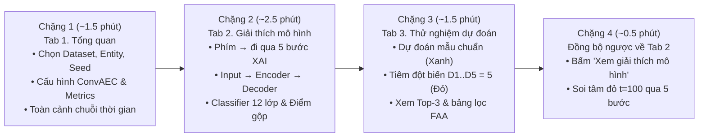

# 🎤 KỊCH BẢN & CẨM NANG THUYẾT TRÌNH LIVE WEB DEMO REDLAMP (CHUẨN GIAO DIỆN MỚI)

* **Môn học:** CS2207 — Khai thác dữ liệu và ứng dụng (GVHD: TS. Võ Nguyễn Lê Duy)
* **Bài báo gốc:** *Robust and Explainable Detector of Time Series Anomaly via Augmenting Multiclass Pseudo-Anomalies (REDLAMP)* — **ACM SIGKDD '25** ([`2505.20765v1.pdf`](./2505.20765v1.pdf))
* **Báo cáo thực nghiệm nhóm:** [`Khai_thác_dữ_liệu_và_ứng_dụng___CS2207_26_1_CH_02.pdf`](./Khai_thác_dữ_liệu_và_ứng_dụng___CS2207_26_1_CH_02.pdf)
* **Tài liệu liên quan:** Tổng quan lý thuyết [`RedLamp_Guide.md`](./RedLamp_Guide.md) | Ví dụ tính tay `ConvAEC` [`RedLamp_ConvAEC_StepByStep.md`](./RedLamp_ConvAEC_StepByStep.md)

> **🎯 Mục tiêu của tài liệu này:**  
> Cung cấp kịch bản thuyết trình trực tiếp **5 – 7 phút** khớp **100% từng nút bấm, từng nhãn chữ và từng con số thực tế** trên giao diện Web Demo hiện tại (`1. Tổng quan` $\rightarrow$ `2. Giải thích mô hình` $\rightarrow$ `3. Thử nghiệm dự đoán`).

---

## 0. Sơ Đồ Luồng Thuyết Trình & Chuẩn Bị Trước Giờ Lên Bục (30 Giây)

### Lộ trình đi thẳng 1 mạch từ trái sang phải (`5 – 7 phút`)

### Khởi chạy nhanh trước khi thuyết trình
1. Nhấp đúp [`../run_demo.bat`](../run_demo.bat) ở thư mục gốc (hoặc chạy `python demo_redlamp/server.py`).
2. Mở trình duyệt tại `http://127.0.0.1:8000`, nhấn **`Ctrl + F5`** một lần cho sạch bộ nhớ đệm rồi nhấn **`F11`** bật toàn màn hình (giao diện thiết kế chuẩn `100vh` không cần cuộn trang trên máy chiếu).

> [!IMPORTANT]
> **2 Bí quyết "sống còn" để thao tác mượt tuyệt đối trên sân khấu:**
> 1. **Mẹo tiêm lỗi báo ĐỎ ngay ở Tab 3 trên tập mặc định `SMD` (`38 đặc trưng`):** Nếu chỉ sửa 1 ô `D1 = 5` và giữ nguyên 37 ô còn lại, điểm kết hợp thô mới đạt `0.1952 < 0.5045` nên mô hình vẫn báo `BÌNH THƯỜNG` (do `MSE` chia trung bình cho cả $100 \times 38 = 3,800$ ô). Để nổ đỏ **`PHÁT HIỆN BẤT THƯỜNG`** ngay lập tức:
>    * **Cách chuẩn nhất trên `SMD`:** Nhập **`5`** vào **5 ô đầu `D1..D5`** $\rightarrow$ nổ đỏ **`Đỉnh nhọn (Spike) - 99.9%`** *(hoặc nhập **`15`** vào 1 ô bất kỳ như `D1` hay `D10`, biểu đồ sẽ tự động bắt và vẽ đúng kênh vừa sửa!)*.
>    * **Cách nhanh 1 ô duy nhất:** Ở Tab 1 chọn **`AIOps / IOPS (1 đặc trưng)`**, sang Tab 3 chỉ có đúng 1 ô nhập, gõ **`5`** $\rightarrow$ nổ đỏ **`Đỉnh nhọn (Spike) - 100.0%`** và xem được luôn bảng lọc `FAA`!
> 2. **Danh sách Thực thể nạp tức thì `0.2 giây` Offline (đã lưu sẵn trong `result/`, không cần Wi-Fi):**
>    * **`SMD (38 đặc trưng)`:** `ALL` *(đại diện bởi `machine-1-1`)*, `machine-1-1` *(Seed 0)*, `machine-1-2` *(Seed 0, 1)*, `machine-1-3` *(Seed 0)*, `machine-1-4` *(Seed 0)*.
>    * **`AIOps / IOPS (1 đặc trưng)`:** `ALL` và thực thể đầu tiên `KPI-05f10d3a-239c-3bef-9bdc-a2feeb0037aa` *(Seed 0)*.
>    * **`MSL (55 đặc trưng)`:** `ALL`, `C-1`, `D-14`, `D-15`, `D-16`, `F-8` *(Seed 0)*.
>    * **`SMAP (25 đặc trưng)`:** `ALL`, `A-1`, `A-2`, `A-3` *(Seed 0)*.
>    * **`UCR (250 thực thể - 1 đặc trưng)`:** `ALL`, `001` *(Seed 0)*.

---

## 1. Chặng 1 (~1.5 Phút): Tab `1. Tổng quan`

Khi vừa mở trang web, Tab **`1. Tổng quan`** đang sáng sẵn với lựa chọn mặc định:
* **`1. Tập dữ liệu (Dataset):`** `SMD (Server Machine Dataset - 38 đặc trưng)`
* **`2. Thực thể (Entity):`** `ALL` *(tổng hợp 28 thực thể; dùng `machine-1-1` làm mẫu đại diện cho các tab sau)*
* **`3. Seed huấn luyện (0 - 4):`** `Seed 0 (Mặc định)`

### Thao tác 1.1: Khối trên cùng — `Bộ chọn Dataset & Entity`
* **🗣️ Lời dẫn gợi ý:**
  > *"Đầu tiên ở Tab **Tổng quan**, hệ thống hiển thị toàn bộ kết quả thực nghiệm mà nhóm **kế thừa mã nguồn gốc của bài báo KDD '25 và huấn luyện chạy lại (tái lập)** trên cả 5 bộ dữ liệu chuẩn là `SMD`, `AIOps`, `MSL`, `SMAP` và `UCR`. Khi chọn `ALL`, hệ thống tổng hợp kết quả trung bình trên toàn bộ 28 máy chủ của `SMD` qua 5 lần chạy lại độc lập từ `Seed 0` đến `Seed 4`."*
* **💡 Điểm nhấn nếu thầy hoặc các bạn trong lớp hỏi thêm về `Seed (0 - 4)`:**
  * Tập `Train / Test` của chuỗi thời gian giữ cố định theo thứ tự thời gian, không xáo trộn ngẫu nhiên. Con số `Seed 0..4` kiểm soát **3 yếu tố ngẫu nhiên lúc huấn luyện**: (1) vị trí, kênh và cường độ chèn 11 kiểu lỗi giả, (2) khởi tạo trọng số ban đầu của mạng `ConvAEC`, và (3) thứ tự xáo trộn các gói *batch* ở mỗi vòng *epoch*.

| Bộ dữ liệu (`Entity = ALL`) | Số đặc trưng (`n_features`) | Đặc điểm dữ liệu nổi bật (EDA báo cáo nhóm) | Kết quả trên Demo (`Seed 0` \| **Trung bình 5 seed** vs. *Paper*) |
| :--- | :---: | :--- | :--- |
| **`SMD`** *(28 thực thể)* | `38` | 28 máy chủ theo dõi CPU, RAM, Disk, Network... trong 5 tuần (`4.21%` lỗi Test); trung vị mỗi sự cố tác động đồng thời **4 đặc trưng**. | • `VUS-ROC`: `0.8163` \| **`0.823 ± 0.005`** *(vượt Paper `0.813`)* • `VUS-PR`: `0.3569` \| **`0.374 ± 0.013`** *(vượt Paper `0.366`)* • `RF`: `0.2290` \| **`0.239 ± 0.009`** *(vượt Paper `0.235`)* |
| **`AIOps / IOPS`** *(29 thực thể)* | `1` | 29 chuỗi KPI web đám mây đơn biến; tập Train **bị nhiễm bẩn sẵn `2.49%` lỗi thật** (9/29 chuỗi nhiễm bẩn $>5\%$). | • `VUS-ROC`: `0.9286` \| **`0.926 ± 0.004`** *(vượt Paper `0.911`)* • `VUS-PR`: `0.4596` \| **`0.458 ± 0.009`** *(vượt Paper `0.448`)* • `RF`: `0.1899` \| **`0.180 ± 0.007`** *(vượt Paper `0.179`)* |
| **`MSL`** *(23 thực thể)* | `55` | Tàu tự hành Sao Hỏa NASA (`13.01%` lỗi Test); trung bình `41.9/54` kênh lệnh giữ hằng số nên dễ sinh *False Anomaly*. | • `VUS-ROC`: `0.7152` \| **`0.731 ± 0.017`** *(Paper `0.753`)* • `VUS-PR`: `0.4307` \| **`0.469 ± 0.022`** *(sát Paper `0.482`)* • `RF`: `0.2205` \| **`0.244 ± 0.024`** *(sát Paper `0.254`)* |
| **`SMAP`** *(49 thực thể)* | `25` | Vệ tinh đo độ ẩm đất NASA (`11.14%` lỗi Test); gộp chung các thực thể khi train vì mỗi chuỗi chỉ dài ~2,752 điểm. | • `VUS-ROC`: `0.6401` \| **`0.628 ± 0.016`** *(Paper `0.642`)* • `VUS-PR`: `0.3373` \| **`0.329 ± 0.015`** *(Paper `0.360`)* • `RF`: `0.1407` \| **`0.142 ± 0.020`** *(Paper `0.196`)* |
| **`UCR`** *(250 thực thể)* | `1` | 250 chuỗi đa lĩnh vực (ECG, ABP, EPG...); Train sạch 0% lỗi, **77.7% đoạn lỗi nằm gọn trong biên độ bình thường** (*lỗi hình thái*). | • `VUS-ROC`: **`0.8970`** *(chuẩn Paper `0.897`)* • `VUS-PR`: **`0.4920`** *(chuẩn Paper `0.492`)* • `RF`: **`0.2340`** *(chuẩn Paper `0.234`)* |

---

### Thao tác 1.2: Khối giữa bên trái — `Thông số cấu hình mô hình`
* **📊 Hiển thị thực tế trên màn hình:**
  * `TRẠNG THÁI NẠP:` **`Model đã nạp trong bộ nhớ`** (huy hiệu xanh lá — file trọng số `bestmodel.pkl` ~4.6 MB đã sẵn sàng trong RAM).
  * `MÔ HÌNH`: **`ConvAEC (Convolutional Autoencoder + NonLinear Classifier)`** — kiến trúc đa tác vụ chữ **Y** gồm thân `ConvEncoder` (4 khối `1D-CNN` `[128, 128, 256, 256]`, `kernel = 4`, `stride = 2`) rẽ ra 2 nhánh: `ConvDecoder` (khôi phục tín hiệu tính `MSE`) và `NonLinear Classifier` (MLP phân loại 12 lớp).
  * `SỐ LỚP PHÂN LOẠI`: **`12 (1 normal + 11 synthetic anomalies)`**.
  * `SỐ ĐẶC TRƯNG (N_FEATURES)`: **`38`** (38 kênh cảm biến đầu vào `D1..D38` của một máy chủ, đã chuẩn hóa Min-Max về `[0, 1]`).
  * `KÍCH THƯỚC CỬA SỔ (W)`: **`100`** (mỗi lần khảo sát một đoạn trượt `100 × 38 = 3,800` con số).
  * `BƯỚC TRƯỢT (STEP)`: **`10`** khi huấn luyện để tăng tốc gấp 10 lần và giảm trùng lặp *(khi kiểm thử trượt từng bước `Stride = 1`)*.
  * `CHIỀU EMBEDDING`: **`128`** — tầng **`Bottleneck`** nén `3,800` giá trị đầu vào về đúng `128` chiều để giữ lại quy luật cốt lõi của trạng thái bình thường, ngăn mạng sao chép nguyên xi điểm lỗi (`Over-generalization`).

---

### Thao tác 1.3: Khối giữa bên phải — `Kết quả đánh giá chất lượng (Metrics)`
* **📊 Số liệu đang hiển thị tại `SMD / ALL / Seed 0`:**
  * **`VUS-ROC`**: **`0.8163`** — `Trung bình 5 seed: 0.823 ± 0.005` *(vượt bài báo gốc `0.813`)*
  * **`VUS-PR`**: **`0.3569`** — `Trung bình 5 seed: 0.374 ± 0.013` *(vượt bài báo gốc `0.366`)*
  * **`RF (RANGE F-SCORE)`**: **`0.2290`** — `Trung bình 5 seed: 0.239 ± 0.009` *(vượt bài báo gốc `0.235`)*
  *(Nếu chọn riêng thực thể `machine-1-1`: `VUS-ROC = 0.9628`, `VUS-PR = 0.6988`, `RF = 0.5383`; trung bình 5 seed đạt `0.969`, `0.752`, `0.565`).*
* **🗣️ Lời dẫn gợi ý:**
  > *"Theo đúng phương pháp đánh giá của bài báo KDD '25, tác giả không dùng chỉ số `F1-PA` cũ (vì chỉ cần chạm trúng 1 điểm là tính đúng cả đoạn lỗi dài, gây điểm ảo) mà đánh giá theo khoảng với thước đo chính là **`VUS-PR`** — phạt rất nặng báo động giả trên dữ liệu hiếm lỗi. Nhóm kế thừa mã nguồn gốc của bài báo và thư viện chuẩn `TSB-AD` được bài báo trích dẫn để huấn luyện và chấm điểm lại: trung bình 5 seed trên toàn tập `SMD` đạt **`0.374 ± 0.013`**, tái lập thành công và bám sát mức `0.366` công bố trong bài báo."*

---

### Thao tác 1.4: Khối dưới cùng — Từ biểu đồ `ALL` $\rightarrow$ Double-click mở chuỗi thời gian (`machine-1-1`)
* **🖱️ Thao tác 2 bước cực mượt:**
  1. **Khi đang ở `ALL`:** Biểu đồ cột bên dưới hiển thị phân bố chỉ số **`VUS-PR`** (có thể đổi sang `VUS-ROC` / `RF`) của toàn bộ **28 máy chủ** (`m1-1` $\rightarrow$ `m3-11`) kèm đường đỏ đứt nét **`Trung bình toàn tập: 0.3569`**. Rê chuột lên vài cột rồi **Double-click vào cột đầu tiên `m1-1` (`machine-1-1`)**!
  2. **Ngay khi double-click vào `m1-1`:** Hệ thống chuyển sang chế độ xem chi tiết chuỗi thời gian của máy chủ **`machine-1-1`**. Rê chuột dọc theo chuỗi thời gian để hiện `Crosshair` + `Tooltip` tọa độ `t` thật; bấm vào hộp **`Tín hiệu hiển thị`** gọn gàng để chuyển giữa **`Độ lệch lớn nhất`**, **`Trung bình cộng`** và bảng lưới 6 cột **`D1 – D38`**. *(Nếu muốn, có thể **Double-click thẳng vào đỉnh `t = 17,407`** trên đồ thị để nhảy sang Tab 2!)*
* **🗣️ Lời dẫn đọc đồ thị:**
  > *"Ở chế độ `ALL`, biểu đồ cột bên dưới cho phép đối chiếu trực tiếp hiệu năng `VUS-PR` giữa cả 28 máy chủ so với đường trung bình toàn tập. Khi nhóm **double-click vào cột máy chủ `machine-1-1`**, hệ thống mở ra toàn bộ **`28,381` bước thời gian** của máy này. Đường **xanh đậm** biểu diễn độ lệch lớn nhất trên cả 38 kênh cảm biến (hoặc có thể chọn xem riêng từng kênh `D1..D38`), còn đường **màu đỏ** là điểm bất thường tổng hợp của REDLAMP. Ở giai đoạn máy chạy ổn định, đường đỏ nằm sát đáy `0.00` không báo động giả; khi phát sinh 8 đợt sự cố (kể cả đợt lỗi đầu tiên ở `t = 6,192` xảy ra cục bộ trên kênh cảm biến phụ), đường đỏ đều bật vọt lên trên mức **`0.50 – 0.53`** vượt ngưỡng `P99.5`, và chạm đỉnh **`1.00`** tại sự cố nghiêm trọng nhất **`t = 17,407`**."*
* **💡 Lưu ý nhanh nếu thầy hoặc bạn hỏi *"Tại sao đa số đỉnh đỏ dừng quanh mức `~0.51` mà chỉ có 1 đỉnh lên `1.00`?"*:**
  * Đó **đều là cảnh báo sự cố**! Theo Công thức (8) của bài báo, điểm tổng hợp lấy trung bình 50%–50% giữa `MinMax(MSE)` và `MinMax(CE)`. Vì tại `t = 17,407` có một cú vọt biên độ cực lớn (`MSE = 0.1230`), phép chuẩn hóa `MinMax` ép `MSE` của các đợt lỗi còn lại xuống `~0.02 – 0.07`; nhưng nhờ nhánh **`Classifier` vẫn bắt trúng biến dạng sóng với xác suất `1.00`**, tổng điểm được kéo vọt lên `(0.03 + 1.00) / 2 ≈ 0.515` — minh chứng trực quan vì sao REDLAMP vượt trội hơn Autoencoder thuần túy!

---

## 2. Chặng 2 (~2.5 Phút): Tab `2. Giải thích mô hình` (Mổ Xẻ 5 Bước Hộp Đen `ConvAEC`)

* **🖱️ Thao tác mở đầu:** Click sang Tab giữa **`2. Giải thích mô hình`** trên thanh Header. Sau đó đặt tay lên hai phím mũi tên **`→`** / **`←`** trên bàn phím để chuyển mượt qua 5 bước như lật slide!
* **📊 Thanh điều khiển phía trên (1 hàng gọn gàng):** Hệ thống tự động định vị sẵn ngay tại đỉnh sự cố cao nhất chuỗi: **`t = 17407`**, đi kèm 2 nút đối chứng nhanh **`Cửa sổ chuẩn`** (`t = 5858`) và **`Đỉnh lỗi`** (`t = 17407`).

---

### Bước 1/5 (`1. Đầu vào`): `Bước 1: Chuỗi thời gian & Input Window (W = 100)`
* **📊 Hiển thị:** Lát cắt 300 điểm quanh sự cố (`17,257 → 17,557`), khung nền hồng viền đỏ nét đứt tô sáng đúng 100 bước **`Cửa sổ [17308, 17407]`**.
* **🗣️ Lời dẫn:** *"Tại thời điểm đỉnh lỗi `t = 17,407`, thay vì xét một điểm rời rạc, REDLAMP cắt trọn khung `Input Window` 100 bước thời gian liên tiếp từ `17,308` đến `17,407` trên cả 38 kênh cảm biến đưa vào mạng."*

---

### Bước 2/5 (`2. Encoder`): `Bước 2: Encoder & Bottleneck Embedding (128 chiều)`
* **🖱️ Thao tác:** Nhấn phím **`→`** sang Bước 2 (có thể bấm thử nút **`Cửa sổ chuẩn`** rồi bấm lại **`Đỉnh lỗi`** để cả lớp thấy `Vector Embedding` bung rộng ra rõ rệt).
* **📊 Hiển thị thực tế:**
  * **Cột trái (`Kiến trúc Encoder (4 khối 1D-CNN)` — trục `[B, C, T]`):** Sơ đồ luồng nén trực quan với thanh thời gian thu hẹp dần qua từng tầng:
    `[1, 38, 100]` $\rightarrow$ `[1, 128, 51]` (`E=0.378`) $\rightarrow$ `[1, 128, 26]` (`E=0.169`) $\rightarrow$ `[1, 256, 14]` (`E=0.209`) $\rightarrow$ `[1, 256, 8]` (`E=0.366`) $\xrightarrow{\text{Global MaxPool1D}}$ `[1, 256, 1]` $\xrightarrow{\text{Conv1x1}}$ **`[1, 128, 1]`** *(các thẻ năng lượng kích hoạt `E` tự động bật đỏ khi cao vượt cửa sổ chuẩn)*.
  * **Cột phải (`Vector Embedding z (d0 → d127)`):**
    * Hai thẻ chỉ số góc phải: **`Δz = 33.91`** (báo đỏ — khoảng cách L2 cách rất xa tâm cụm bình thường) và **`Cosine = 0.721`**.
    * **Dải `Heatmap` kép 128 chiều** ở trên (`Normal` nhạt màu đối chiếu trực tiếp với `t=17407` rực xanh/đỏ) kết hợp **biểu đồ cột phân kỳ quanh trục `0.0`** ở dưới (chiều dương `+` hướng lên màu xanh dương, chiều âm `-` hướng xuống màu đỏ, chồng trên nền `Chuẩn` xám nhạt của cửa sổ bình thường).
* **🗣️ Lời dẫn:** *"Qua 4 khối `1D-CNN` nối tiếp ở bên trái, cửa sổ `38 channels × 100 steps` được nén dần chiều thời gian về đúng **`Bottleneck` `Vector Embedding` 128 chiều** ở bên phải. So với `Baseline` êm ả của cửa sổ bình thường, sự cố tại `t = 17,407` làm biên độ không gian ẩn bung mạnh cả hai chiều âm dương với **`L2 Distance` `Δz = 33.91`** — minh họa trực tiếp Figure 1 của bài báo: điểm bất thường bị đẩy văng khỏi cụm bình thường trước khi tách sang `Decoder` (Bước 3) và `Classifier` (Bước 4)."*

---

### Bước 3/5 (`3. Decoder`): `Bước 3: Tái tạo tín hiệu qua Decoder & sai số MSE`
* **🖱️ Thao tác:** Nhấn phím **`→`** sang Bước 3. Chỉ vào 2 biểu đồ đặt song song cùng thang đo.
* **📊 Hiển thị thực tế:**
  * **Biểu đồ trái — `Cửa sổ khảo sát (Target, t=17407)`:** Đường `Gốc` (xanh đậm) vọt tách hẳn khỏi đường `Tái tạo` (xanh dương) $\rightarrow$ **`MSE = 0.1230`**.
  * **Biểu đồ phải — `Cửa sổ chuẩn (Normal, t=5858)`:** Đường `Tái tạo` ôm khít đường `Gốc` $\rightarrow$ **`MSE = 0.0005`**.
* **🗣️ Lời dẫn:** *"Ở nhánh thứ nhất là `Decoder`, nhờ lúc huấn luyện các điểm chèn lỗi giả đã bị che bằng **`Anomaly Mask = 0`**, mạng chỉ học cách tái tạo quy luật bình thường. Vì thế ở cửa sổ chuẩn bên phải sai số chỉ là **`0.0005`**, còn tại đỉnh sự cố bên trái mạng không tái tạo theo lỗi nên sai số vọt lên **`0.1230`** — cao gấp **226 lần**!"*

---

### Bước 4/5 (`4. Classifier`): `Bước 4: Phân loại 12 lớp Pseudo-Anomaly & lọc FAA`
* **🖱️ Thao tác:** Nhấn phím **`→`** sang Bước 4. So sánh 2 biểu đồ cột 12 lớp trái – phải.
* **📊 Hiển thị thực tế:**
  * **Bên phải (`Cửa sổ chuẩn t=5858`):** Cột đầu tiên `normal` (màu xám nhạt) cao tuyệt đối **`99.88%`**, 11 lớp lỗi cộng lại chỉ `0.12%`.
  * **Bên trái (`Cửa sổ khảo sát t=17407`):** Cột `normal` sập xuống **`0.01%`**; cột cao nhất bật **đỏ rực** là **`flip` (`Flip - Đảo chiều đoạn sóng`): `40.3%`**, theo sau là `mixture` (`27.8%`), `scale` (`17.8%`), `contextual` (`8.9%`), `spike` (`4.5%`). Tổng xác suất bất thường hợp lệ đạt **`0.9999` (`99.99%`)**!
* **🗣️ Lời dẫn:** *"Ở nhánh thứ hai là `Classifier` 12 lớp `Pseudo-Anomaly`, tại cửa sổ bình thường mạng khẳng định `99.88%` là `normal`, còn tại cửa sổ sự cố mạng nhận diện ngay hình thái biến dạng giống kiểu `flip` và `mixture` với tổng xác suất lỗi lên tới **`99.99%`**. Các cột xám nhạt là lớp `normal` và các lớp có xác suất trung bình toàn chuỗi vượt `0.05` đã bị bộ lọc **`FAA`** tự động gán điểm về `0` để chống báo động giả."*

---

### Bước 5/5 (`5. Kết hợp`): `Bước 5: Combined Score (Reconstruction + Classification)`
* **🖱️ Thao tác:** Nhấn phím **`→`** sang Bước 5. Chỉ vào thẻ công thức màu xanh nhạt ngay dưới đồ thị.
* **📊 Hiển thị thực tế trong hộp `CÔNG THỨC`:**
  $$(\text{MSE} + \text{CE}) / 2 = (0.1230 + 0.9999) / 2 = \mathbf{0.5615} \quad \left(\text{P99.5} = 0.5045 \Rightarrow \textbf{BẤT THƯỜNG}\right)$$
* **🗣️ Lời dẫn:** *"Bước 5 tổng hợp quyền biểu quyết 50%–50% của cả hai nhánh: lấy `(0.1230 + 0.9999) / 2 = 0.5615`, vượt ngưỡng `Percentile P99.5 = 0.5045` và kết luận chính xác **BẤT THƯỜNG**!"*

---

## 3. Chặng 3 & 4 (~2 Phút): Tab `3. Thử nghiệm dự đoán` & Đồng Bộ Ngược Về Tab 2

* **🖱️ Thao tác:** Click sang Tab cuối cùng **`3. Thử nghiệm dự đoán`** để trình diễn suy luận trực tiếp (*Live Sandbox*).
* **Cơ chế hoạt động (Cột trái):** Điểm mới nhập vào sẽ đứng ở vị trí cuối cửa sổ (**`t = 100`**), ghép sau **99 điểm ngữ cảnh trước đó** lấy từ `(a) 99 điểm cuối chuỗi mẫu` *(mặc định)*, `(b) Trung vị (median) của chuỗi`, hoặc `(c) Tự dán dữ liệu lịch sử`. Ngưỡng quyết định đặt mặc định theo phân vị 99.5% của các cửa sổ chuẩn (**`0.5045 (P99.5)`**).

---

### Thao tác 3.1: Kiểm chứng mẫu Bình thường mặc định (5 giây — Xanh lá)
1. **🖱️ Thao tác:** Giữ nguyên các ô gợi ý mặc định (`D1 = 0.097`, `D2 = 0.079`, `D3 = 0.08`, `D4 = 0.08`, `D5 = 0`...) $\rightarrow$ Bấm nút xanh **`⚡ Dự đoán bất thường`**.
2. **📊 Kết quả hiện ra tức thì:**
   * Hộp kết luận bật **XANH LÁ**: **`BÌNH THƯỜNG`** (*"Raw Combined (0.0004) < Threshold (0.5045)"*).
   * Phân loại 12 lớp báo **XANH LÁ**: **`Bình thường (100.0%)`**.
   * 4 thẻ điểm: `MSE = 0.0007` | `CE = 0.0001` | `Raw Combined Score = 0.0004` | `Threshold (P99.5) = 0.5045`.

---

### Thao tác 3.2: Tiêm đột biến giả lập sự cố máy chủ (Live Anomaly Injection — Báo Đỏ)

Bạn có thể thực hiện ngay trên màn hình đang mở (**Kịch bản A**) hoặc mời thầy và các bạn chọn kênh bất kỳ (**Kịch bản B**):

#### Kịch bản A (Khuyên dùng — Ngay trên `SMD` đang mở, không cần chuyển Dataset)
1. **🖱️ Thao tác:** Sửa **5 ô đầu tiên** thành số **`5`** (`D1 = 5`, `D2 = 5`, `D3 = 5`, `D4 = 5`, `D5 = 5`) $\rightarrow$ Bấm **`⚡ Dự đoán bất thường`**.
2. **🗣️ Lời dẫn ghi điểm EDA:**
   > *"Theo thống kê EDA trong báo cáo nhóm, mỗi sự cố thực tế trên máy chủ `SMD` thường tác động đồng thời lên trung vị 4–5 cảm biến cùng lúc. Nhóm giả lập một xung tăng vọt lên mức `5.0` trên 5 kênh `D1..D5` tại thời điểm `t = 100`."*
3. **📊 Kết quả nổ ĐỎ tức thì:**
   * Kết luận bật **ĐỎ RỰC**: **`BẤT THƯỜNG`** (*"Raw Combined (0.5164) > Threshold (0.5045)"*).
   * Phân loại 12 lớp báo **ĐỎ**: **`Đỉnh nhọn (Spike) (99.9%)`**.
   * 4 thẻ điểm: `MSE = 0.0329` *(tăng vọt **47 lần**)* | `CE = 1.0000` *(`100%`)* | **`Raw Combined Score = 0.5164`** > `Threshold (P99.5) = 0.5045`.
   * Đồ thị góc dưới phải (`Cửa sổ 100 điểm & chuỗi tái tạo — D1`): Đường gốc tại `t=100` dựng đứng lên `5.0`, tách rời hoàn toàn khỏi đường tái tạo `Autoencoder` màu xanh dương!

#### Kịch bản B (Biểu diễn thêm nếu thầy hoặc các bạn yêu cầu sửa thử 1 ô bất kỳ hoặc xem bảng lọc FAA)
* **Nếu thầy hoặc bạn trong lớp bảo *"Thử gõ vào 1 cảm biến bất kỳ khác xem sao, ví dụ `D10`"*:** Giữ nguyên các ô khác, gõ **`D10 = 15`** $\rightarrow$ Bấm dự đoán: nổ đỏ **`BẤT THƯỜNG`** (`Raw Combined = 0.5300 > 0.5045`), và biểu đồ bên dưới **tự động chuyển sang vẽ đúng `— D10`**!
* **Nếu muốn biểu diễn trực quan bảng lọc `FAA (> 0.05)`:** Quay sang Tab 1 chọn **`AIOps / IOPS (1 đặc trưng)`**, sang Tab 3 gõ **`5.0`** vào ô duy nhất $\rightarrow$ nổ đỏ `0.6063 > 0.5010` (`Đỉnh nhọn (Spike) (100.0%)`), bấm mở dòng **`▶ Các lớp bị lọc FAA`** sẽ thấy bảng gạch bỏ trực tiếp lớp **`speedup`** vì xác suất trung bình toàn chuỗi `0.054 > 0.05`!

---

### Thao tác 3.3 (Chặng 4 — Chốt hạ ấn tượng 30 giây): Đồng bộ ngược về Tab 2
* **🖱️ Thao tác:** Ngay dưới thẻ đỏ `Đỉnh nhọn (Spike) (99.9%)`, bấm nút xanh đang phát sáng **`🔍 Giải thích điểm này ở Tab 2 (5 bước)`**.
* **📊 Hiệu ứng khép kín vòng lặp:**
  * Giao diện tự động chuyển về **Tab `2. Giải thích mô hình`**, thanh trạng thái đổi sang nền đỏ: **`Điểm nạp: t = 100`** kèm huy hiệu đỏ **`[Đỉnh nhọn (Spike)]`**.
  * Bấm phím **`→`** lướt nhanh qua Bước 1 $\rightarrow$ Bước 3 $\rightarrow$ Bước 4 $\rightarrow$ Bước 5: tâm tròn đỏ **`Điểm nạp mới (t=100)`** được theo dõi xuyên suốt từ cửa sổ đầu vào, sai số tái tạo Decoder cho tới biểu đồ 12 lớp (`spike` dựng cột đỏ `99.9%`) và điểm kết hợp vượt ngưỡng! *(Khi muốn quay về chuỗi kiểm thử ban đầu, chỉ cần bấm nút `◀ Chuỗi mẫu` ngay trên thanh trạng thái).*

---

## 4. Bộ 7 Câu Hỏi Thảo Luận & Q&A Trọng Tâm Cuối Buổi Thuyết Trình

### Câu 1: Tại sao REDLAMP chọn mạng `ConvAEC` mà không dùng `Transformer`, `LSTM` hay `Diffusion`?
* **Trả lời:** Vì 3 lý do cốt lõi:
  1. **Cần kết hợp cả Tái tạo + Phân loại (`AEC`):** Mô hình tái tạo thuần túy (`Anomaly Transformer`, `Diffusion`) dễ bị *over-generalization* — vẽ đẹp cả lỗi nhiễm bẩn và bỏ sót lỗi hình thái tinh vi (trên `UCR`, `AT` chỉ đạt `VUS-PR = 0.132` so với `0.492` của `RedLamp`). Ngược lại, bỏ nhánh tái tạo (`w/o L_MSE`) làm `VUS-PR` trên `SMD` sụt tới `23.7%`.
  2. **`1D-CNN + MaxPool1d` bắt biến dạng cục bộ bất biến vị trí:** 11 kiểu lỗi giả được chèn ở đoạn ngẫu nhiên trong cửa sổ $W=100$. Bộ lọc tích chập 1D kết hợp `MaxPool1d` bắt hình dáng sóng cục bộ cực nhạy dù lỗi nằm đầu, giữa hay cuối cửa sổ, và không bị "đói dữ liệu" trên chuỗi ngắn (~2,400 điểm ở `SMAP`/`MSL`) như `Transformer`.
  3. **Tốc độ huấn luyện khi dữ liệu nhân gấp $12\times$:** Mỗi cửa sổ sinh ra 12 lớp làm tập train lớn gấp 12 lần; `1D-CNN` tính song song toàn cửa sổ nhanh hơn hẳn `LSTM` tuần tự và dùng chung duy nhất 1 bộ siêu tham số cho cả 5 tập dữ liệu.

### Câu 2: Tập `SMD` có tới 38 cảm biến (`38 đặc trưng`), tại sao vẫn gọi là `1D-CNN`? Và "1 kênh" có phải là "1 máy chủ (`machine`)" không?
* **Trả lời:**
  * **`1 machine` (`machine-1-1`) là `1 Thực thể (Entity)`** độc lập có 1 model riêng, không phải 1 kênh.
  * Bên trong 1 máy chủ đó mới có **38 kênh cảm biến đầu vào** (`D1..D38`). Chữ **`1D`** trong `1D-CNN` chỉ **số chiều trượt của bộ lọc**: mỗi bộ lọc ở tầng đầu có kích thước `4 bước thời gian × 38 kênh cảm biến`, ôm trọn cả 38 cảm biến cùng lúc và **chỉ trượt dọc theo 1 trục duy nhất là trục thời gian**.

### Câu 3: Tại sao Công thức (8) trong bài báo chuẩn hóa `MinMax` trên toàn chuỗi, còn ở Tab 3 lại so sánh điểm kết hợp thô với ngưỡng `P99.5`?
* **Trả lời:** Hệ thống tính đầy đủ cả hai! Điểm chuẩn hóa `MinMax` $\in [0, 1]$ dùng để vẽ trên Tab 1 và chấm `VUS-ROC`, `VUS-PR`, `RF` trên toàn tập Test. Tuy nhiên, `MinMax` luôn kéo giá trị lớn nhất của mọi chuỗi lên `1.0` kể cả khi chuỗi hoàn toàn sạch không có lỗi. Do đó khi dự đoán trực tuyến từng mẫu mới ở Tab 3, hệ thống đối chiếu **điểm kết hợp thô `(MSE + CE) / 2`** với **phân vị 99.5% (`P99.5`)** của phân phối cửa sổ chuẩn để kết luận nhị phân ổn định, không phụ thuộc tương lai.

### Câu 4: Nhãn dự đoán trên Demo (như `Spike - 99.9%` hay `Flip - 40.3%`) có khẳng định nguyên nhân hỏng hóc vật lý của phần cứng không?
* **Trả lời:** Không khẳng định nguyên nhân vật lý phần cứng, mà cung cấp **khả năng giải thích về mặt hình thái toán học (*morphological explainability*)**: cho kỹ sư vận hành biết đoạn tín hiệu bất thường đang mang hình dáng biến dạng nào (gai nhọn đột ngột, trôi dạt xu hướng, nhiễu rung hay đứt gãy tín hiệu) dựa trên khoảng cách trong không gian ẩn 128 chiều.

### Câu 5: Chi tiết "Double Softmax" nhóm phát hiện trong code gốc tác giả là gì?
* **Trả lời:** Trong code gốc (`RedLamp/models/classifier.py` và `meta.py`), đầu ra của `NonLinClassifier` đã đi qua tầng `nn.Softmax`, nhưng khi tính hàm mất mát lúc huấn luyện lại đưa tiếp vào `nn.CrossEntropyLoss` của PyTorch (bên trong tự gọi `LogSoftmax` lần thứ hai). Nhóm giữ nguyên thiết kế gốc (`fix_double_softmax=False`) để đảm bảo tính tái lập trung thực và đạt kết quả khớp sát, vượt nhẹ bài báo trên `SMD` và `AIOps`.

### Câu 6: Bộ lọc `FAA` ($\delta = 0.05$) có hạn chế gì khi triển khai thực tế?
* **Trả lời:** Có 2 điểm cần lưu ý: (1) `FAA` cần thống kê xác suất trung bình trên toàn chuỗi kiểm thử ($\bar{y}_c > 0.05$), nên khi chạy streaming thời gian thực phải ước lượng từ tập Validation hoặc cửa sổ lịch sử dài gần nhất; (2) Với các hệ thống có tỷ lệ lỗi thật kéo dài vượt quá 5% thời gian (như `SMAP` `11.14%`, `MSL` `13.01%`), ngưỡng cứng `5%` có thể vô tình lọc nhầm lớp đang bắt lỗi thật.

### Câu 7: Vì sao chỉ số `VUS-PR` tái lập trên tập `SMAP` (`0.329`) thấp hơn một chút so với bài báo (`0.360`)?
* **Trả lời:** Repo gốc của tác giả chỉ lưu mảng điểm `anomaly_score.npy` mà không kèm script tính metric, nên nhóm kế thừa trực tiếp thư viện chuẩn `TSB-AD` / `vus` được bài báo trích dẫn để chạy chấm điểm. Độ lệch nhỏ `-0.031` trên `SMAP` đến từ: (1) danh sách thực thể `SMAP` trong code gốc bị lặp thực thể `P-2` hai lần (49 thực thể thay vì 50), (2) khác biệt điểm dừng sớm (*early stopping patience = 10*), và (3) cách căn lề cửa sổ trượt trên các chuỗi ngắn.
