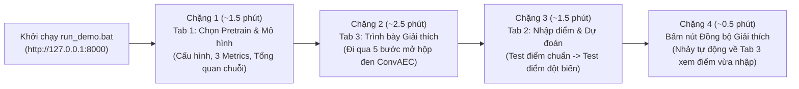

# 🎤 CẨM NANG THUYẾT TRÌNH CHI TIẾT WEB DEMO REDLAMP (TỪNG THAO TÁC & TỪNG SỐ LIỆU)

**Môn học:** CS2207 — Khai thác dữ liệu và ứng dụng (GVHD: TS. Võ Nguyễn Lê Duy)  
**Bài báo gốc:** *Robust and Explainable Detector of Time Series Anomaly via Augmenting Multiclass Pseudo-Anomalies (REDLAMP)* — **ACM SIGKDD '25** ([`2505.20765v1.pdf`](./2505.20765v1.pdf))  
**Báo cáo thực nghiệm nhóm:** [`Khai_thác_dữ_liệu_và_ứng_dụng___CS2207_26_1_CH_02.pdf`](./Khai_thác_dữ_liệu_và_ứng_dụng___CS2207_26_1_CH_02.pdf)  
**Tài liệu lý thuyết nền tảng tổng hợp:** [`RedLamp_Guide.md`](./RedLamp_Guide.md)

> **🎯 Mục tiêu của tài liệu này:**  
> Cung cấp kịch bản **cầm tay chỉ việc trên máy chiếu** cho phần trình diễn ứng dụng `demo_redlamp`: bấm nút nào, đọc con số nào, con số đó được tính từ công thức nào và trả lời câu hỏi xoáy của hội đồng ra sao. Toàn bộ con số trong tài liệu này là **số thật 100%** xuất ra từ checkpoint mô hình PyTorch của nhóm.

---

## 0. Tổng Quan Bối Cảnh & 3 "Bẫy" Sống Còn Cần Biết Trước Khi Lên Bục Giảng

Trong bài thuyết trình đồ án cuối kỳ (**30 – 35 phút**, chiếm 50% điểm môn học; mỗi câu trả lời phản biện tốt được cộng **+0.5 điểm**), phần **Live Web Demo** nên kéo dài **5 – 7 phút** ngay sau khi nhóm trình bày xong *Methodology* và *Experiments*.

### Khởi động trước giờ thuyết trình (30 giây)
1. Nhấp đúp tệp [`../run_demo.bat`](../run_demo.bat) ở thư mục gốc dự án (hoặc chạy lệnh `python demo_redlamp/server.py`).
2. Trình duyệt tự động mở `http://127.0.0.1:8000`. Nhấn phím **`F11`** để bật toàn màn hình (giao diện thiết kế chuẩn `100vh` Zero-Scroll vừa khít khung chiếu, chữ lớn tối thiểu `24px` trên đồ thị).

> [!WARNING]
> **3 Lưu ý "sống còn" trên giao diện thực tế để không bị khựng trên sân khấu:**
> 1. **Thứ tự 3 nút Tab trên thanh Header thực tế:** Từ trái sang phải là **`1. Chọn Pretrain & Mô hình`** $\rightarrow$ **`2. Nhập điểm & Dự đoán`** $\rightarrow$ **`3. Trình bày Giải thích`**. Luồng dẫn chuyện thuyết phục nhất cho người nghe là: **`Tab 1` $\rightarrow$ bấm sang `Tab 3` (giải phẫu 5 bước bên trong mạng trên chuỗi mẫu có sẵn) $\rightarrow$ quay về `Tab 2` (nhập tay điểm mới để test trực tiếp) $\rightarrow$ bấm nút `🔍 Xem giải thích cho điểm này (Đồng bộ)` để tự động bay ngược sang `Tab 3`**.
> 2. **Bẫy nhập số trên tập mặc định `SMD / machine-1-1` (`38 dims`):** Nếu ở Tab 2 bạn chỉ sửa 1 ô `D1 = 5.0` và giữ nguyên 37 chiều còn lại, mô hình **VẪN BÁO `TRẠNG THÁI BÌNH THƯỜNG`** (`Điểm kết hợp thô = 0.1952 < Ngưỡng P99.5 = 0.5045`) vì sai số `MSE` tính trung bình trên cả $38 \times 100 = 3,800$ phần tử! Để kích hoạt báo đỏ **`PHÁT HIỆN BẤT THƯỜNG`** tức thì:
>    * **Trên `SMD / machine-1-1`:** Sửa **5 ô đầu `D1..D5` cùng bằng `5.0`** (ra nhóm *Đỉnh nhọn - Spike 99.9%*), hoặc nếu chỉ sửa 1 ô thì gõ **`D1 = 15.0`**.
>    * **Hoặc chuyển sang tập 1 chiều `AIOps / IOPS`:** Chỉ có **1 ô nhập duy nhất**, gõ **`3.0`** hoặc **`5.0`** là nổ đỏ *Đỉnh nhọn - Spike 100.0%* ngay lập tức!
> 3. **Danh sách Thực thể đã có sẵn Offline trên ổ cứng (`result/`) — Bấm ăn ngay trong 0.2 giây không cần Wi-Fi giảng đường:**
>    * **`SMD (38 dims)`:** `machine-1-1` (Seed 0), `machine-1-2` (Seed 0, 1), `machine-1-3` (Seed 0), `machine-1-4` (Seed 0).
>    * **`AIOps / IOPS (1 dim)`:** Thực thể đầu tiên `KPI-05f10d3a-239c-3bef-9bdc-a2feeb0037aa` (Seed 0).
>    * **`MSL (55 dims)`:** `C-1`, `D-14`, `D-15`, `D-16`, `F-8`... (Seed 0).
>    * **`SMAP (25 dims)`:** `A-1`, `A-2`, `A-3` (Seed 0).
>    * **`UCR (Anomaly Archive - 1 dim)`:** `001` (Seed 0).
>    *(Nếu chọn thực thể/seed ngoài danh sách trên, hệ thống sẽ tải On-Demand từ Kaggle `ngphcdanh/redlamp-retraining` mất vài giây nếu có mạng).*

---

## 1. Chặng 1 (~1.5 Phút): Tab `1. Chọn Pretrain & Mô hình`

Khi mở trang web, hệ thống nạp sẵn **`SMD (Server Machine Dataset - 38 dims)`** $\rightarrow$ **`machine-1-1`** $\rightarrow$ **`Seed 0 (Mặc định)`**.

### Thao tác 1.1: Khối trên cùng — `Bộ chọn Dataset & Entity`
* **Hành động:** Bấm mở hộp thả xuống **`1. Tập dữ liệu (Dataset)`** để giới thiệu đủ **5 bộ dữ liệu chuẩn của bài báo KDD '25**, sau đó giữ ở `SMD / machine-1-1 / Seed 0`.
* **Bảng đối chiếu ý nghĩa `dims` & kết quả tái lập của nhóm (Table 2 & Table 4 trong báo cáo):**

| Tên trên Demo | Số đặc trưng (`dims` = $D$) | Đặc điểm EDA cốt lõi từ báo cáo nhóm | Kết quả tái lập 5 Seeds của Nhóm vs. Bài báo gốc (`VUS-PR`) |
| :--- | :---: | :--- | :--- |
| **`SMD`** *(Server Machine)* | `38 dims` | 28 máy chủ theo dõi 38 features (CPU, RAM, Disk, Network...) suốt 5 tuần; tỷ lệ lỗi Test `4.21%`; trung vị mỗi đoạn lỗi tác động đồng thời lên **4 chiều**. | Nhóm đạt **`0.374 ± 0.013`** (**vượt** bài báo gốc `0.366`). |
| **`AIOps / IOPS`** *(Cloud KPIs)* | `1 dim` | 29 chuỗi KPI web đám mây đơn biến; tập Train **bị nhiễm bẩn sẵn `2.49%` lỗi thật** (9/29 chuỗi nhiễm bẩn $>5\%$). | Nhóm đạt **`0.458 ± 0.009`** (**vượt** bài báo gốc `0.448`). |
| **`MSL`** *(Mars Rover)* | `55 dims` | 23 thực thể tàu tự hành Sao Hỏa NASA (`13.01%` lỗi Test); trung bình `41.9/54` cột lệnh giữ hằng số nên dễ sinh *False Anomaly*. | Nhóm đạt **`0.469 ± 0.022`** (sát bài báo gốc `0.482`, nằm gọn trong 1 độ lệch chuẩn). |
| **`SMAP`** *(NASA Satellite)* | `25 dims` | Vệ tinh đo độ ẩm đất NASA (`11.14%` lỗi Test); gộp chung các kênh khi train 1 model chia sẻ vì mỗi kênh chỉ dài ~2,752 điểm. | Nhóm đạt **`0.329 ± 0.015`** (bài báo `0.360`; do kênh `P-2` lặp 2 lần trong code gốc & căn chỉnh cửa sổ). |
| **`UCR`** *(Anomaly Archive)* | `1 dim` | 250 chuỗi đa lĩnh vực (ECG, ABP, EPG...); tập Train sạch 0% lỗi, **77.7% đoạn lỗi nằm gọn trong biên độ bình thường** (*lỗi hình thái*). | Hiển thị số chuẩn bài báo: `VUS-ROC = 0.8970`, `VUS-PR = 0.4920`, `RF = 0.2340`. |

---

### Thao tác 1.2: Khối giữa bên trái — `Thông số cấu hình mô hình`
* **Hành động:** Chỉ chuột qua từng ô trong bảng cấu hình của `machine-1-1`.
* **Ý nghĩa từng con số:**
  1. **`Trạng thái nạp: Model đã nạp trong bộ nhớ`** (Huy hiệu xanh): Xác nhận checkpoint trọng số thực tế (`bestmodel.pkl`) đã nạp vào PyTorch trên CPU.
  2. **`Mô hình: ConvAEC (Convolutional Autoencoder + NonLinear Classifier)`**: Kiến trúc tích chập 1 chiều kết hợp bộ phân loại MLP phi tuyến.
  3. **`Số lớp phân loại: 12 (1 normal + 11 synthetic anomalies)`**: Gồm lớp `0` (*Normal*) và 11 lớp bất thường giả sinh tự động.
  4. **`Số chiều (n_features): 38`**: Chính là `dims = 38` cảm biến đầu vào tại mỗi mốc thời gian $t$ (đã chuẩn hóa Min-Max về `[0, 1]` theo tập Train).
  5. **`Kích thước cửa sổ (W): 100`**: Mỗi lần mô hình nhìn 1 đoạn dài 100 bước thời gian liên tiếp $\rightarrow$ ma trận đầu vào có kích thước `100 × 38` (3,800 con số).
  6. **`Bước trượt (Step): 10`**: Lúc huấn luyện trượt 10 bước/lần để giảm dư thừa dữ liệu; lúc kiểm thử trượt từng bước một (`stride = 1`) để chấm điểm toàn bộ chuỗi.
  7. **`Chiều Embedding: 128`**: Dù đầu vào là `1 dim` hay `55 dims`, khối `Encoder` luôn nén toàn bộ cửa sổ 100 bước về cố định **128 đặc trưng ẩn** ở cổ chai (*bottleneck*).

---

### Thao tác 1.3: Khối giữa bên phải — `Kết quả đánh giá chất lượng (Metrics)`
* **Số liệu thực tế hiện trên màn hình (`SMD / machine-1-1 / Seed 0`):**
  * **`VUS-ROC`**: **`0.9628`** *(Dòng phụ: `Trung bình 5 seed: 0.969 ± 0.006`)*
  * **`VUS-PR`**: **`0.6988`** *(Dòng phụ: `Trung bình 5 seed: 0.752 ± 0.036`)*
  * **`RF (Range F-score)`**: **`0.5383`** *(Dòng phụ: `Trung bình 5 seed: 0.565 ± 0.025`)*
* **Cách giải thích sâu sắc từng chỉ số:**
  * **Tại sao loại bỏ `F1-PA` (Point Adjustment) cũ?** `F1-PA` chỉ cần đoán trúng 1 giây trong sự cố kéo dài 100 giây là tính đúng cả 100 giây, khiến điểm số ngẫu nhiên cũng đạt F1 cao giả tạo. Do đó nhóm tự xây dựng bộ chấm điểm theo khoảng (*Range-based*) trên thư viện `TSB-AD`.
  * **`VUS-ROC = 0.9628` (`0.969 ± 0.006`):** *Volume Under the Surface* mở rộng biên đoạn lỗi bằng vùng đệm (buffer tối đa $W/2 = 50$ bước) và tính thể tích dưới mặt cong ROC trên mọi ngưỡng cắt và mọi độ dài vùng đệm. Con số `0.969` sát mức hoàn hảo `1.0` cùng độ lệch chuẩn siêu nhỏ `± 0.006` qua 5 hạt giống độc lập (`Seed 0..4`) chứng minh độ ổn định rất cao.
  * **`VUS-PR = 0.6988` (`0.752 ± 0.036`) — Thước đo chính của KDD '25:** Vì lỗi ngoài thực tế rất hiếm (`0.85% – 13%`), `ROC` chia báo động giả cho số điểm bình thường khổng lồ nên dễ cao ảo; ngược lại **`VUS-PR` (Precision-Recall)** phạt cực nặng mọi báo động giả. Đạt trung bình `0.752` trên máy chủ 38 chiều không nhãn là mức hiệu năng rất mạnh.
  * **`RF = 0.5383` (`0.565 ± 0.025`):** Điểm F1 tính trên cấp độ phân đoạn tại ngưỡng $\mu + 3\sigma$, có trừ điểm phạt nếu một sự cố liền mạch bị phát hiện vụn vặt đứt đoạn.

---

### Thao tác 1.4: Khối dưới cùng — `Tổng quan toàn bộ chuỗi thời gian của Entity`
* **Giải thích biểu đồ:**
  * **Trục ngang (`t`):** Toàn bộ chuỗi kiểm thử dài **`28,381` bước thời gian** của `machine-1-1`.
  * **Đường xám đậm (`Chuỗi đo lường - Chiều 1`):** Giá trị cảm biến đầu tiên `D1` (dao động nền quanh `0.05 – 0.25`).
  * **Đường đỏ (`Điểm bất thường tương đối` — `anomaly_score`):** Điểm kết hợp cuối cùng theo Công thức (8) sau khi làm mượt 50 bước và chuẩn hóa Min-Max về `[0, 1]`.
  * **Điểm nhấn chỉ tay trên máy chiếu:** Ở các đoạn máy chạy bình thường (ví dụ quanh `t = 5,858`), đường đỏ nằm sát rạt đáy `0.00`. Tại vùng sự cố lớn (đỉnh cực đại tại **`t = 17,407`** chạm `1.00`), đường đỏ dựng vọt thẳng đứng tách biệt rõ rệt!

---

## 2. Chặng 2 (~2.5 Phút): Tab `3. Trình bày Giải thích` (Walkthrough 5 Bước Mở Hộp Đen)

> [!TIP]
> **Thao tác sân khấu chuyên nghiệp:** Bấm vào Tab **`3. Trình bày Giải thích`** ở góc phải Header, sau đó dùng hai phím mũi tên **`→`** (Tiếp theo) và **`←`** (Quay lại) trên bàn phím để chuyển mượt qua 5 Slide giải phẫu mô hình!

### Thanh điều khiển trên cùng
* Mặc định tự động định vị ngay tại đỉnh lỗi cao nhất chuỗi: **`Vị trí cửa sổ (t): 17407`**.
* Có 2 nút nhảy đối chứng tức thì: **`Xem cửa sổ chuẩn`** (`t = 5858`, nằm trong nhóm 10% điểm thấp nhất chuỗi) và **`Xem cửa sổ đỉnh lỗi`** (`t = 17407`).

---

### Bước 1/5 (~0.5 phút): `Chuỗi thời gian & Tô sáng cửa sổ 100 điểm đang xét`
* **Hiển thị trên màn hình:** Vẽ lát cắt 300 điểm xung quanh đỉnh lỗi (`t` từ `17,257` đến `17,557`). Khung chữ nhật nền hồng nhạt viền đỏ nét đứt đóng khung chính xác **100 điểm từ `17,308` đến `17,407`** (góc phải hiện huy hiệu **`Cửa sổ [17308, 17407]`**).
* **Lời dẫn:** Để xét thời điểm `t = 17,407`, REDLAMP không nhìn 1 con số cô lập mà cắt nguyên khung ngữ cảnh 100 bước thời gian trước đó ($100 \times 38$) đưa vào mạng `ConvAEC`.

---

### Bước 2/5 (~0.5 phút): `Mạng trích xuất đặc trưng (Encoder -> Embedding)`
* **Hành động:** Bấm phím **`→`** sang Bước 2. Click mở dòng **`Chi tiết kỹ thuật: Năng lượng kích hoạt các tầng Conv`** ở cột trái.
* **Cột trái — Giải thích từng con số kích thước Tensor thật qua 7 tầng `1D-CNN`:**
  1. `Cửa sổ đầu vào`: **`[1, 100, 38]`** (`Batch = 1`, `Window = 100`, `Dims = 38`).
  2. `ConvBlock 0 (stride 2)`: **`[1, 128, 51]`** — 128 "kính lúp" tích chập 1D (`kernel = 4`, `stride = 2`, `padding = 2` + BatchNorm + ReLU + Dropout `0.2`) trượt dọc trục thời gian, nén độ dài từ `100` xuống `51`.
  3. `ConvBlock 1 (stride 2)`: **`[1, 128, 26]`** — Nén thời gian từ `51` xuống `26`.
  4. `ConvBlock 2 (stride 2)`: **`[1, 256, 14]`** — Tăng gấp đôi lên `256` bộ lọc để bắt hình thái phức tạp, độ dài còn `14`.
  5. `ConvBlock 3 (stride 2)`: **`[1, 256, 8]`** — Tầng tích chập sâu nhất bao quát toàn cửa sổ, nén độ dài về `8`.
  6. `MaxPool1D (to length 1)`: **`[1, 256, 1]`** — Lấy giá trị kích hoạt cực đại dọc 8 mốc thời gian, gom về độ dài `1` (giúp bất biến dù lỗi nằm ở đầu, giữa hay cuối cửa sổ).
  7. `Conv1x1 -> Embedding`: **`[1, 128, 1]`** — Cô đọng 256 kênh thành **véc-tơ tiềm ẩn `Embedding` 128 chiều**.
* **Số liệu thực từ PyTorch Forward Hook (trong mục `Chi tiết kỹ thuật`):**
  * Hiện rõ: **`conv_0: 0.0222 | conv_1: 0.0808 | conv_2: 0.1343 | conv_3: 0.1230`**.
  * *Ý nghĩa:* Năng lượng kích hoạt trung bình tăng vọt gấp **6 lần** từ tầng nông (`0.0222`) lên tầng sâu (`0.1343`), cho thấy các bộ lọc cấp cao đã bắt trúng sự biến dạng cấu trúc của đoạn sóng!
* **Cột phải — `Biểu đồ véc-tơ Embedding (128 chiều)`:**
  * Trực quan hóa toàn bộ 128 con số (`d0` đến `d127`): cột dương màu **xanh dương** (`d0 = +1.65`, `d1 = +3.36`...), cột âm màu **đỏ** (`d3 = -6.50`, `d4 = -3.77`...). Từ đúng 128 con số này, mạng rẽ làm 2 nhánh ở Bước 3 và Bước 4.

---

### Bước 3/5 (~0.5 phút): `Mạng giải mã tái tạo (Decoder) & Sai số bình phương`
* **Hành động:** Bấm phím **`→`** sang Bước 3. Đối chiếu 2 biểu đồ đặt song song cùng thang đo:
  * **Bên trái — `Cửa sổ đang xét (t=17407)`:** Đường `Gốc` (xám đậm) vọt lệch hẳn khỏi đường `Tái tạo` của Decoder (xanh dương) $\rightarrow$ Huy hiệu đỏ báo **`MSE = 0.1230`**.
  * **Bên phải — `Cửa sổ bình thường đối chứng (t=5858)`:** Đường `Tái tạo` bám khít đường `Gốc` $\rightarrow$ Huy hiệu báo **`MSE = 0.0005`** (`0.000543`).
* **Điểm nhấn toán học:** Sai số tái tạo tại đỉnh lỗi cao **gấp ~226 lần** cửa sổ bình thường! Nhờ cơ chế **Mặt nạ che lỗi `Anomaly Mask` ($1 - W$)** ở Công thức (2) nhân vùng lỗi giả với `0` lúc train, Decoder tuyệt đối không học vẹt lỗi mà chỉ biết vẽ lại trạng thái bình thường.

---

### Bước 4/5 (~0.5 phút): `Bộ phân loại xác suất 12 loại bất thường giả định`
* **Hành động:** Bấm phím **`→`** sang Bước 4. Chỉ vào sự đảo chiều xác suất giữa 2 biểu đồ cột 12 lớp:
  * **Bên trái (`Cửa sổ khảo sát t=17407`):**
    * Lớp `normal` (cột đầu tiên, màu xám nhạt) tụt xuống chỉ còn **`0.01%`**!
    * Cột cao nhất tô **màu đỏ rực** là **`flip` (Đảo cực): `40.3%`**, tiếp theo là các cột xanh dương `mixture` (`27.8%`), `scale` (`17.8%`), `contextual` (`8.9%`), `spike` (`4.5%`).
    * Tổng điểm phân loại các lớp bất thường hợp lệ đạt **`raw_ce = 0.9999` (`99.99%`)**!
  * **Bên phải (`Cửa sổ bình thường t=5858`):**
    * Cột `normal` (xám nhạt) chiếm tới **`99.88%`**, cả 11 lớp lỗi cộng lại chỉ còn **`0.12%`**!
* **Cách giải thích cột xám nhạt & Bộ lọc FAA ($\delta = 0.05$ — Công thức 6):**
  * Các cột tô **màu xám nhạt** bị gạch điểm về `0` khi tính `ce_score`, gồm: (1) Lớp `normal` (luôn loại) và (2) Bất kỳ lớp lỗi giả nào có xác suất trung bình toàn chuỗi $> 0.05$ (`5%`) — tức lớp *False Anomaly* vô hại.
  * *Ví dụ thực tế ngay trong bộ dữ liệu Offline của nhóm:* Trên `machine-1-1`, không có lớp lỗi giả nào vượt 5% (cao nhất là `spike = 4.01%`). Nhưng nếu đổi sang **`SMD / machine-1-4`**, lớp `speedup` có trung bình toàn chuỗi **`13.24% > 5%`** và `cutoff` có **`5.67% > 5%`** (hay trên **`AIOps / KPI-05f10d3a...`**, lớp `speedup` có **`5.38% > 5%`**) $\rightarrow$ FAA tự động tô xám và loại bỏ chúng khỏi tổng điểm để triệt tiêu báo động giả!

---

### Bước 5/5 (~0.5 phút): `Điểm kết hợp & Công thức tính điểm cuối cùng`
* **Hành động:** Bấm phím **`→`** sang Bước 5.
* **Biểu đồ phía trên:** Gồm 3 đường theo thời gian (`Điểm tái tạo MSE` màu xám đậm, `Điểm phân loại CE` màu xanh dương, `Điểm thô kết hợp` màu đỏ đậm) cắt vọt qua đường kẻ ngang nét đứt đỏ **`Ngưỡng: 0.505`**.
* **Hộp `CÔNG THỨC KẾT HỢP VỚI SỐ LIỆU THỰC TẾ` ở bên dưới:** Hiện trực tiếp phép tính tại `t = 17,407`:
  $$\text{Điểm cuối} = \frac{\text{Điểm tái tạo} + \text{Điểm phân loại}}{2} = \frac{0.1230 + 0.9999}{2} = \mathbf{0.5615} \quad \left(\text{Ngưỡng P99.5} = 0.5045 \implies \textbf{BẤT THƯỜNG}\right)$$
* **Ý nghĩa chốt lại:** Dù riêng `MSE` tại đây chỉ ở mức vừa phải (`0.1230`), nhánh `Classifier` đã bắt trúng hình thái biến dạng với độ tự tin `0.9999`, kéo điểm kết hợp lên **`0.5615 > 0.5045`** để bắt gọn sự cố!

---

## 3. Chặng 3 & 4 (~2 Phút): Tab `2. Nhập điểm & Dự đoán` & Đồng Bộ Ngược Sang Tab 3

Bấm sang Tab giữa **`2. Nhập điểm & Dự đoán`** để thực hiện **suy luận trực tiếp (Live Inference)**.

### Cấu trúc đầu vào ở cột trái
* Điểm mới nhập vào sẽ đứng ở vị trí cuối cùng (`t = 100`), ghép sau **99 điểm ngữ cảnh trước đó** từ 1 trong 3 nguồn: `(a) 99 điểm cuối của chuỗi mẫu` *(Mặc định)*, `(b) Lặp lại giá trị trung vị của chuỗi`, hoặc `(c) Tự dán / tải lên lịch sử`.
* Thanh trượt **`Ngưỡng quyết định điểm thô`** mặc định ở **`0.5045 (P99.5)`**.

---

### Thao tác 3.1: Kịch bản 1 — Kiểm chứng trạng thái Bình thường (Baseline)
1. **Hành động:** Giữ nguyên các ô giá trị trung vị mặc định của `SMD / machine-1-1` (`D1 = 0.097`, `D2 = 0.079`, `D3 = 0.08`, `D4 = 0.08`, `D5 = 0`...) $\rightarrow$ Bấm **`⚡ Thực hiện dự đoán bất thường`**.
2. **Số liệu hiện ra tức thì:**
   * Kết luận **XANH LÁ**: **`TRẠNG THÁI BÌNH THƯỜNG`** (*"Điểm kết hợp thô (0.0004) nằm dưới ngưỡng an toàn (0.5045)"*).
   * Nhóm phân loại **XANH LÁ**: **`Bình thường (normal) - 100.0%`**.
   * 4 ô điểm số: `MSE = 0.0007` | `CE = 0.0001` | `Điểm kết hợp thô = 0.0004` | `Ngưỡng P99.5 = 0.5045`.

---

### Thao tác 3.2: Kịch bản 2 — Bơm Đột Biến Giả Lập Sự Cố (Live Anomaly Injection)

Bạn có thể chọn **1 trong 2 phương án** dưới đây (đã kiểm chứng số thật 100%):

#### Phương án A (Thực hiện ngay trên `SMD / machine-1-1` đang mở — Không cần đổi Dataset)
1. **Hành động:** Nhập số **`5`** vào **5 ô đầu tiên** (`D1 = 5`, `D2 = 5`, `D3 = 5`, `D4 = 5`, `D5 = 5`) $\rightarrow$ Bấm **`⚡ Thực hiện dự đoán bất thường`**.
   * *Lời dẫn ghi điểm:* *"Theo phân tích EDA ở Mục 4.1 báo cáo nhóm, mỗi sự cố máy chủ SMD thực tế tác động đồng thời lên trung vị khoảng 4–5 chiều cảm biến, nên em giả lập xung đột biến lên mức 5.0 trên 5 kênh D1 đến D5."* *(Nếu chỉ muốn sửa 1 ô duy nhất trên SMD, hãy nhập **`D1 = 15`** $\rightarrow$ ra `0.5296 > 0.5045`, nhóm `Trôi dạt xu hướng - Wander 99.9%`).*
2. **Số liệu hiện ra khi nhập `D1..D5 = 5`:**
   * Kết luận đổi sang **ĐỎ RỰC**: **`PHÁT HIỆN BẤT THƯỜNG`** (*"Điểm kết hợp thô (0.5164) vượt ngưỡng quy định (0.5045)"*).
   * Thẻ Phân loại 12 nhóm báo **ĐỎ**: **`Đỉnh nhọn (Spike) (spike) - 99.9%`** — *"Biến động tăng/giảm biên độ đột biến cục bộ tại 1-2 điểm"*.
   * 4 ô điểm số: `MSE = 0.0329` (tăng **47 lần**!) | `CE = 1.0000` (`100%`!) | `Điểm kết hợp thô = 0.5164` > `Ngưỡng P99.5 = 0.5045`.
   * Đồ thị góc dưới phải: Tại `t = 100`, đường gốc (xám đậm) vọt thẳng đứng lên `5.0`, tách hẳn khỏi đường tái tạo Autoencoder (xanh dương)!

#### Phương án B (Chuyển ở Tab 1 sang `AIOps / IOPS (1 dim)` — Gõ đúng 1 ô duy nhất + Show luôn bảng FAA)
1. **Hành động:** Chọn `AIOps / IOPS (1 dim)` (tự nạp `KPI-05f10d3a...`, 1 ô nhập mặc định trung vị `0.3603` báo `BÌNH THƯỜNG` với điểm `0.0001 < 0.5010`). Sửa ô đó thành **`5.0`** $\rightarrow$ Bấm **`⚡ Thực hiện dự đoán bất thường`**.
2. **Số liệu hiện ra:**
   * Kết luận **ĐỎ**: **`PHÁT HIỆN BẤT THƯỜNG`** — **`Đỉnh nhọn (Spike) (spike) - 100.0%`**.
   * 4 ô điểm số: `MSE = 0.2126` | `CE = 1.0000` | `Điểm kết hợp thô = 0.6063` > `Ngưỡng P99.5 = 0.5010`.
   * Bấm mở **`Xem các lớp bị loại khỏi điểm phân loại (Lớp bình thường & Tần suất > 0,05)`**: hiện rõ bảng loại trừ cả **`normal`** lẫn **`speedup` (`Xác suất trung bình toàn chuỗi (0.054) > ngưỡng 0,05`)**!

---

### Thao tác 3.3: Chặng 4 — Chốt Hạ Bằng Nút `🔍 Xem giải thích cho điểm này (Đồng bộ)`
* **Hành động:** Bấm nút **`🔍 Xem giải thích cho điểm này (Đồng bộ)`** vừa sáng viền xanh ngay dưới thẻ kết quả đỏ.
* **Hiệu ứng trình chiếu:** Hệ thống tự động nhảy sang **Tab `3. Trình bày Giải thích`**, thanh trạng thái đổi sang nền đỏ nhạt **`Đang giải thích: Điểm nạp thủ công (t=99) [Đỉnh nhọn (Spike)]`**, vẽ **tâm điểm tròn đỏ phát sáng `Điểm nạp mới (t=99)`** xuyên suốt Bước 1 $\rightarrow$ Bước 3 $\rightarrow$ Bước 4 $\rightarrow$ Bước 5!

---

## 4. Bộ 7 Câu Hỏi Phản Biện Q&A Đắt Giá Nhất (Săn Trọn +0.5 Điểm Thưởng)

### Câu 1: Tại sao tác giả chọn kiến trúc `ConvAEC` mà không dùng `Transformer`, `LSTM/RNN` hay `Diffusion`?
* **Trả lời:** Có 3 lý do cốt lõi cả về lý thuyết lẫn thực nghiệm:
  1. **Tại sao phải ghép đôi `Autoencoder + Classifier` (`AEC`):** Mô hình tái tạo thuần túy (như `Anomaly Transformer`, `Diffusion`) dễ bị *over-generalization* — vẽ đẹp luôn cả lỗi nhiễm bẩn và bỏ sót lỗi hình thái tinh vi (trên UCR, `AT` chỉ đạt `VUS-PR = 0.132` so với `0.492` của `RedLamp`). Ngược lại, nếu bỏ nhánh tái tạo chỉ giữ Classifier (`w/o L_MSE`), điểm sụt tới `23.7%` trên SMD. Dùng chung 1 cổ chai `Embedding 128 chiều` vừa giữ được chuẩn bình thường, vừa tạo không gian đa lớp có tính giải thích (XAI).
  2. **Tại sao xương sống là `1D-CNN + Global MaxPool`:** 11 phép biến đổi tạo lỗi giả là biến dạng hình thái cục bộ chèn ở vị trí ngẫu nhiên `[st : ed]` trong cửa sổ $W=100$. `1D-CNN` kết hợp `MaxPool1D` toàn cục bắt hình dáng sóng cục bộ cực nhạy và **bất biến với vị trí lỗi**, đồng thời không bị "đói dữ liệu" trên các chuỗi ngắn (~2,400 điểm ở SMAP/MSL) như `Transformer`.
  3. **Bài toán dữ liệu nhân bản gấp $12\times$:** Mỗi cửa sổ gốc sinh ra 12 phiên bản làm dữ liệu train tăng gấp 12 lần. `LSTM/RNN` tính tuần tự theo thời gian rất chậm, còn `1D-CNN` tính song song toàn cửa sổ cực nhanh và kế thừa nền tảng chống nhiễu nhãn từ kiến trúc **SREA (ECML 2021)**, cho phép dùng cố định 1 bộ tham số trên cả 5 tập dữ liệu.

### Câu 2: Dữ liệu `SMD` có tới `38 dims` (38 cảm biến), tại sao mạng vẫn gọi là `1D-CNN` chứ không phải `2D-CNN`?
* **Trả lời:** Chữ **`1D`** chỉ **số hướng trượt của bộ lọc (`kernel`)**, không phải số lượng cảm biến! Với cửa sổ `100 × 38`, mỗi bộ lọc `kernel_size = 4` có kích thước `4 × 38` ôm trọn cả 38 cảm biến cùng một lúc và chỉ **trượt dọc theo 1 trục duy nhất là trục thời gian** (từ bước 1 đến bước 100).

### Câu 3: Tại sao Công thức (8) trong bài báo có chuẩn hóa `MinMax` trước khi chia đôi, còn ở Tab 2 và Bước 5 trên Demo lại so sánh điểm thô `(raw_mse + raw_ce) / 2` với ngưỡng `P99.5`?
* **Trả lời:** Hệ thống tính đủ cả hai! Điểm chuẩn hóa `MinMax` trên toàn chuỗi (`anomaly_score` $\in [0, 1]$) được dùng ở Tab 1 và để chấm `VUS-ROC`, `VUS-PR`, `RF`. Tuy nhiên, phép `MinMax` luôn kéo cực đại của **mọi chuỗi** lên bằng `1.0` kể cả khi chuỗi hoàn toàn sạch không có lỗi, và sẽ làm méo thang đo lịch sử nếu chèn 1 điểm đột biến cực lớn lúc suy luận trực tuyến (*online*). Vì vậy, để kết luận nhị phân `BẤT THƯỜNG` / `BÌNH THƯỜNG` cho từng điểm mới ở Tab 2, hệ thống đối chiếu trực tiếp **điểm kết hợp thô** với **phân vị 99.5% (`P99.5`)** của các cửa sổ chuẩn.

### Câu 4: Nhãn dự đoán trên Demo (ví dụ `Spike - 99.9%` hay `Flip - 40.3%`) có khẳng định chính xác nguyên nhân lỗi vật lý của máy móc không?
* **Trả lời:** Dạ không khẳng định nguyên nhân vật lý phần cứng, mà mang ý nghĩa **giải thích hình thái toán học (*morphological explainability*)**: nó chỉ ra đoạn tín hiệu lỗi thật đang nằm gần cụm biến dạng toán học nào nhất trong không gian tiềm ẩn 128 chiều (ví dụ lỗi nhịp sinh học EPG nằm sát cụm `Speedup`, lỗi nhiễu huyết áp ABP nằm sát cụm `Noise`).

### Câu 5: Chi tiết "Double Softmax" nhóm phát hiện trong code gốc tác giả là gì?
* **Trả lời:** Trong code gốc của tác giả (Mục 4.2 báo cáo nhóm), đầu ra của `NonLinear Classifier` đã đi qua một hàm `Softmax`, nhưng khi tính hàm mất mát phân loại lúc train lại truyền tiếp vào `nn.CrossEntropyLoss` của PyTorch (bên trong gọi `LogSoftmax` lần thứ hai). Nhóm giữ nguyên thiết kế này (`fix_double_softmax=False`) để tái lập trung thực số liệu công bố và đạt kết quả khớp sát, thậm chí vượt nhẹ bài báo trên `AIOps` và `SMD`.

### Câu 6: Bộ lọc FAA ($\delta = 0.05$) có điểm yếu nào khi triển khai thực tế không?
* **Trả lời:** Có 2 điểm cần lưu ý (Mục 4.1 & 5.4 báo cáo): (1) FAA cần thống kê trung bình xác suất trên toàn tập Test ($\bar{y}_c > 0.05$), nên khi chạy streaming thời gian thực phải ước lượng ngưỡng loại trừ từ tập Validation hoặc cửa sổ lịch sử dài gần nhất; (2) Trên các tập có tỷ lệ lỗi thật rất dày vượt quá 5% như `SMAP` (`11.14%`) và `MSL` (`13.01%`), ngưỡng cố định `5%` có rủi ro lọc nhầm lớp đang bắt lỗi thật kéo dài.

### Câu 7: Tại sao kết quả tái lập của nhóm trên `SMAP` (`VUS-PR = 0.329`) thấp hơn một chút so với bài báo (`0.360`)?
* **Trả lời:** Code gốc của tác giả chỉ xuất mảng `anomaly_score.npy` chứ không công bố code tính metric. Nhóm phải tự viết module đánh giá trên `TSB-AD`. Độ lệch `-0.031` trên `SMAP` đến từ: (1) danh sách kênh `SMAP` trong code gốc bị lặp kênh `P-2` hai lần (49 kênh), (2) khác biệt luồng ngẫu nhiên khi dừng sớm (*early stopping patience = 10*), và (3) quy ước căn chỉnh điểm số cửa sổ vào mốc thời gian trên các chuỗi ngắn.
